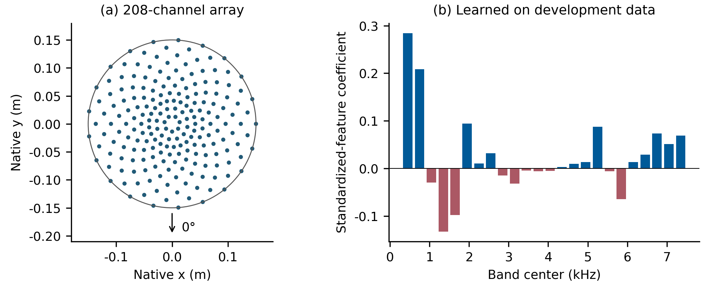
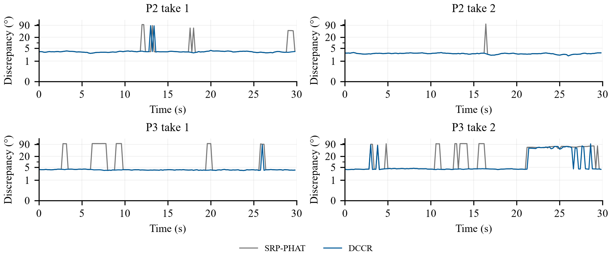

# Acoustic Detection and Direction Finding of Unmanned Aerial Vehicles Using Direction Conditioned Coherence Ranking

1st Ju Luo

College of Computer Science and Technology

Nanjing University of Aeronautics and Astronautics

Nanjing, China

ytxlj12345@163.com

2nd Yuqian Zhou*

College of Computer Science and Technology

Nanjing University of Aeronautics and Astronautics

Nanjing, China

zhouyuqian@nuaa.edu.cn

Abstract—Coherent background sources can dominate an acoustic spatial map and obscure the bearing of an unmanned aerial vehicle. This study proposes direction-conditioned coherence ranking, which scores four steered-response-power candidates using 24 coherence-band features and class-balanced ridge regression. Recordings from a 208-channel array are partitioned by acquisition group: 100 m for development, and 150 and 200 m for held-out evaluation. Across 600 aircraft windows, the mean discrepancy from nominal reference directions decreases from 14.78° to 6.97° relative to the phase-transform baseline. The detection rate is 85.7%, with a 1.5% false-alarm rate over 200 background windows. Under a shared detector, joint detection and localization within 10° increases from 76.5% to 85.5%. Gains primarily reflect fewer large direction errors. Evidence is limited to one aircraft model, one acquisition day, nominal static references, correlated windows, and local background calibration.

Keywords-UAV acoustics, microphone array, direction of arrival, spatial coherence, candidate ranking.

## Introduction

Passive acoustic sensing must detect unmanned aerial vehicle (UAV) emissions and estimate their bearing in noisy environments, where low signal-to-noise ratios hinder localization [1]. Generalized cross-correlation estimates pairwise delays [2], while steered response power (SRP) aggregates correlation evidence over candidate directions [3], [4]. The phase transform (PHAT) emphasizes phase alignment, so coherent non-UAV sources can also dominate the response. Existing SRP extensions improve spectral reliability and spatial search [4], but multiplying an entire spatial map by a positive detection weight leaves its maximizing direction unchanged.

In this paper, we propose direction-conditioned coherence ranking (DCCR), which ranks four SRP-PHAT proposals using directional coherence spectra. Training includes competing directions from the same aircraft observations, which share background and overall gain. The contribution is candidate-conditioned source association using established array operations. A shared-detector comparison separates changes in bearing selection from changes in alarm decisions.

The practical question is whether the direction selected by an acoustic array belongs to the UAV. A strong spatial peak establishes agreement with a propagation delay pattern, but does not by itself identify the emitting source. Conversely, an alarm derived from a spectrum averaged across microphones does not specify which peak should be reported. DCCR links these decisions by evaluating the acoustic evidence separately at each proposed bearing, then using the best candidate score for detection.

## Related Work

SNR-weighted beamforming with particle tracking [5], PHAT-β partial spectral whitening [6], and SRP with a spatially separated auxiliary microphone [7] address noise and reverberation under different operating conditions. UAV approaches exploit rotor harmonics [8] or combine synthesized signals with neural localization [9]. DCCR uses fixed frequency bands and a compact linear model; no direct comparison with those trained neural systems is available. DDL [10] synchronizes audio with flight-log positions, whereas UaVirBASE [11] documents measured static configurations. The present recordings support nominal static-bearing comparisons but lack synchronized trajectories for tracking evaluation.

Rotor-generated sound contains harmonic components whose spacing depends on propeller rotation and blade count [8]. This gives acoustic detection a source-related cue beyond broadband sound level. In DCCR, no rotor speed or harmonic spacing is estimated explicitly. Instead, the frequency distribution of spatially coherent sound is represented by 24 bands and learned from the development recordings. This choice allows the same representation to inform source detection and bearing selection, while leaving transfer to other rotor configurations an empirical question.

## Signal Model and Directional Representation

### Array and spectral estimates

For microphone position rm and far-field unit direction u, the received signal is approximated by

$$ x_m(t)=a_m s(t+\mathbf{r}_m^{T}\mathbf{u}/c)+v_m(t). $$ (1)

where am is a channel gain, vm is background and sensor noise, and c = 343 m/s. The 0.30 m aperture is small relative to the 100–200 m nominal ranges. Search is restricted to the upper hemisphere to resolve planar-array mirror ambiguity. Clockwise azimuth a starts at native negative y; elevation e is above the array plane:

$$ \mathbf{u}(a,e)=(-\cos e\sin a,-\cos e\cos a,\sin e)^{T}. $$ (2)

The aperture bounds the intermicrophone propagation delay by approximately 0.30/343 = 0.875 ms, or 14 samples at 16 kHz. Delay interpolation therefore reduces numerical quantization but cannot remove uncertainty in sensor positions, channel phase or sound speed. Across the analysis band, wavelengths range from about 1.14 m at 300 Hz to 0.046 m at 7500 Hz. Low frequencies provide smaller phase differences across the aperture, whereas higher frequencies can yield ambiguous phase patterns for individual pairs [4]. Combining multiple baselines and frequencies supplies complementary directional evidence. The far-field model estimates azimuth and elevation; it provides no independent range measurement.

Each 200 ms window is centered by channel and resampled from 48 to 16 kHz using an anti-aliasing polyphase filter. A 512-sample periodic Hann window and 256-sample hop yield L = 11 centered Fourier frames over 300–7500 Hz. Let Xm(l,k) denote the spectrum at frame l and bin k. The cross- and auto-spectra are

$$ R_{ij}(k)=L^{-1}\sum_{l=1}^{L}X_i(l,k)X_j(l,k)^{*},\qquad P_i(k)=R_{ii}(k). $$ (3)

The coherence-normalized and PHAT spectra are

$$ C_{ij}(k)=\frac{R_{ij}(k)}{\max(\sqrt{P_i(k)P_j(k)},\epsilon)},\qquad Q_{ij}(k)=\frac{R_{ij}(k)}{\max(|R_{ij}(k)|,\epsilon)}. $$ (4)

The floor is 10⁻¹² times mean in-band channel power, bounded below by 10⁻³⁰. Averaging precedes normalization to avoid unit-magnitude single-frame coherence. All methods use 1124 pairs spanning all 208 channels: index offsets 17, 35, 53, 71, 89 and 103 modulo 208, deduplicated and restricted to baselines of at least 0.06 m.

The distinction between the two normalizations is important for UAV sensing. Away from the numerical floor, PHAT gives a nonzero cross-spectrum unit magnitude and retains its phase, including bins whose interchannel agreement is weak. Coherence normalization also retains the degree of agreement, so weakly coherent components contribute less to the directional features. With only one Fourier frame, the magnitude of the normalized cross-product would be unity away from the floor; averaging cross- and auto-spectra first makes the magnitude informative. Nevertheless, a coherent interferer can also produce a large value. Coherence alone is therefore insufficient to identify a UAV, motivating a learned comparison across frequency bands.

### Proposals and coherence features

For microphone-pair set P and frequency-bin set F, an unnormalized PHAT response is

$$ B(\mathbf{u})=\sum_{(i,j)\in\mathcal{P}}\sum_{k\in\mathcal{F}}\operatorname{Re}\{Q_{ij}(k)e^{-j2\pi f_k(\mathbf{r}_i-\mathbf{r}_j)^{T}\mathbf{u}/c}\}. $$ (5)

A 1257-point horizontal direction-cosine grid with 0.05 spacing is searched in descending score order, retaining four directions separated by at least 12°. Each is refined over ±0.05 at 0.005 spacing, then over ±1° azimuth and ±2° elevation at 0.1° spacing. These are numerical search steps, not physical accuracy guarantees. Eightfold inverse-FFT interpolation and linear lag lookup approximate the response up to a constant scale.

The 300–7500 Hz range is divided into 24 adjacent 300 Hz bands, including the final bin. For the bin set Fb of band b, candidate u has feature

$$ f_b(\mathbf{u})=\frac{1}{|\mathcal{P}|\,|\mathcal{F}_b|}\sum_{(i,j)\in\mathcal{P}}\sum_{k\in\mathcal{F}_b}\operatorname{Re}\{C_{ij}(k)e^{-j2\pi f_k(\mathbf{r}_i-\mathbf{r}_j)^{T}\mathbf{u}/c}\}. $$ (6)

These signed features retain frequency-dependent directional support. Positive gains cancel away from the numerical floor. The regressor receives only the 24 band values; absolute power, bearing coordinates, recording identity, range and video are excluded. Fig. 1 shows the geometry and fitted coefficients.

For a candidate consistent with the arriving wave, the steering factor compensates intermicrophone phase differences and the real parts tend to add constructively. A mismatched direction leaves residual phases that can cancel within a band. Thus, two peaks with similar broadband PHAT responses may have different coherence spectra. Equation (8) exploits this distinction: positive and negative fitted coefficients reward or suppress particular standardized band responses. These coefficients describe discrimination within the development data, rather than a universal UAV emission spectrum. Unlike a scalar multiplier applied to an entire spatial map, candidate-dependent scores can change the selected direction.

## Learning and Joint Inference

### Development and regularization

P1 supplies 300 aircraft and 100 background windows. Training proposals use the coarse PHAT grid. Reference-steered beams and proposals within 5° of the nominal direction are positive; proposals at least 15° away and background proposals are negative. Intermediate proposals are excluded. Reference beams are never used at inference. The 1779 examples comprise 598 positives and 1181 negatives, including 781 wrong aircraft directions.

Fig. 1. Array geometry and coefficients of the standardized coherence bands, fitted using development data only.

Two grouped folds each hold out one aircraft recording and one contiguous 10 s half of the development background, keeping each window's examples together. This does not test transfer across independent background recordings. Class-balanced feature means and standard deviations are fitted within each fold, with a standard-deviation floor of 0.01. For N examples with standardized features zn and labels yn ∈ {−1,+1}, the model minimizes

$$ \sum_{n=1}^{N}w_n(\boldsymbol{\beta}^{T}\mathbf{z}_n+b-y_n)^2+\lambda\|\boldsymbol{\beta}\|_2^2. $$ (7)

The coefficient vector is β and the intercept is b. Each class has total weight N/2; b is unpenalized. Balanced validation squared error selects λ = 100 from {0.1, 1, 10, 100}, followed by refitting on all development examples. Removing the 781 wrong-direction negatives gives the ablation model, which selects λ = 10 with the same folds and otherwise unchanged inference.

### Selection and calibration

For the four audio-generated candidates, with training feature means μ and standard deviations σ,

$$ s_q=\boldsymbol{\beta}^{T}[(\mathbf{f}(\mathbf{u}_q)-\boldsymbol{\mu})/\boldsymbol{\sigma}]+b,\qquad q^{*}=\operatorname{argmax}_{q}s_q. $$ (8)

The selected direction and detection score are uq* and sq*. Scores are regression outputs, not posterior probabilities. Each method uses the same 25 background windows per test group, temporally disjoint from evaluation windows. At nominal upper-tail level 0.05, the order-statistic rank ceil(26 × 0.95) is 25; detection requires a score strictly above the calibration maximum. Correlation and nonstationarity preclude a formal 5% false-alarm guarantee. All aircraft windows receive bearings, including missed detections; joint success additionally requires detection and discrepancy ≤10°.

Inference consequently has two separate decisions. First, the largest of the four scores selects a bearing, even when all candidates resemble background. Second, comparison with the calibrated threshold determines whether that bearing is accompanied by a UAV alarm. Calibration is applied to the maximum candidate score, matching the quantity used at inference; calibrating individual candidate scores would describe a different decision rule. A rejected observation still contributes to the reported all-window angular statistics, but not to joint detection and localization success. This distinction prevents accurate bearings on missed detections from being counted as successful UAV surveillance.

## Field Experiment

### Recordings and evaluation split

We use recordings supplied for the 4th Shenghua Cup Acoustic Technology Competition: an upward-facing CRY8501/SonoCam Pi array captured a DJI Air 3S on 25 May 2026 [12]. Each acquisition group supplies two aircraft recordings and one background recording (Table I), with 208 channels at 48 kHz, 16-bit PCM. The nine recordings total 273.75 s. Channel sample counts agree within each recording, and no sample reaches the PCM limits across 1872 WAV files; this does not independently verify phase or clock calibration. Nominal bearings come from acquisition diagrams, without synchronized trajectories to quantify hovering displacement or reference uncertainty. Videos are not estimator inputs or ground truth.

Table I. Recording groups and nominal directions; two aircraft takes and one background recording per group.

| Group | Range | Azimuth take 1 / take 2 | Elev. | Role |
| --- | --- | --- | --- | --- |
| P1 | 100 m | 225.00° / 251.50° | 88.3° | Development |
| P2 | 150 m | 97.17° / 92.41° | 60.0° | Held-out evaluation |
| P3 | 200 m | 131.88° / 135.00° | 66.4° | Held-out evaluation |

The first 30 s of each aircraft take is used. Background intervals [0,5), [5,10) and [10,30) s provide subtraction references, threshold calibration and negative evaluation, respectively. P2/P3 contribute 600 aircraft and 200 background windows, plus 50 separate calibration windows. P1 is development only. Local background calibration is an explicit operating assumption.

### Comparisons and measures

Baselines share geometry, pairs, frequency band and search: SRP-PHAT; smoothed coherence transform (SCOT)-SRP using Cij; and coherence-weighted PHAT using Qij clip((L|Cij|²−1)/(L−1),0,1). The last weight is a finite-snapshot heuristic, not an unbiased estimate under overlapping frames. A reference-subtraction baseline estimates per-channel gain from median current-to-reference power ratios, subtracts the scaled background cross-spectrum, and weights residual phase by residual coherence and excess-power reliability. Its operations are specified in the code; it is not a reproduction of [5].

Directions are evaluated under each method's calibrated detector and under a shared DCCR detector. The former operating points need not have equal false-alarm rates. Candidate-oracle selection uses reference labels only after inference. For estimated and nominal reference unit vectors,

$$ e_{\mathrm{ang}}=\frac{180}{\pi}\arccos[\operatorname{clip}(\widehat{\mathbf{u}}^{T}\mathbf{u}_{\mathrm{ref}},-1,1)]. $$ (9)

Localization includes all 600 aircraft windows. The true-positive rate (TPR) and false-positive rate (FPR) use aircraft and background windows, respectively. Temporal dependence precludes treating the 800 windows as independent trials; results are descriptive and include four recording-level paired differences. Code, model and input hashes were frozen before held-out execution. Runtime uses an Intel Core i7-12700KF, Python 3.12.14, NumPy 2.2.6 and SciPy 1.15.3, with numerical threads requested as one. Timings include shared front-end overhead, exclude file I/O, and are not an isolated benchmark.

## Results

### Localization

DCCR reduces mean discrepancy from 14.78° to 6.97° (a 7.82° reduction computed from unrounded values), with median 3.47°, 95th percentile 54.16°, and 94.0% within 10° (Table II).

Mean discrepancy decreases in all four aircraft recordings. For P2 takes 1 and 2, PHAT/DCCR means are 6.95°/4.28° and 3.23°/2.55°; for P3 they are 17.32°/4.16° and 31.62°/16.87°. Paired reductions, calculated before rounding, are 2.67°, 0.68°, 13.16° and 14.76°, respectively. The larger reductions at P3 reflect greater scope to correct competing peaks in these recordings. They do not establish that performance improves with range, because range, bearing and acoustic conditions change together. The candidate oracle yields 6.44° mean discrepancy and 94.3% within 10°; this retrospective, reference-assisted diagnostic measures coverage and is not an estimator output.

Table II. Discrepancies from nominal bearings for all 600 held-out aircraft windows, including missed detections.

| Method | Mean ° | Median ° | 95th pct. ° | ≤5° % | ≤10° % |
| --- | --- | --- | --- | --- | --- |
| SRP-PHAT | 14.78 | 3.49 | 96.87 | 84.8 | 84.8 |
| SCOT-SRP | 15.35 | 3.46 | 96.87 | 84.0 | 84.0 |
| Coherence PHAT | 18.46 | 3.43 | 95.78 | 80.0 | 80.0 |
| Reference subtraction | 12.19 | 3.51 | 71.83 | 87.2 | 87.2 |
| DCCR without hard negatives | 6.97 | 3.47 | 54.16 | 94.0 | 94.0 |
| DCCR | 6.97 | 3.47 | 54.16 | 94.0 | 94.0 |

### Detection and ablation

DCCR detects 514/600 windows (85.7%) with 3/200 false alarms (1.5%; Table III). P2/P3 detection rates are 83.0%/88.3%, and false-alarm rates are 0.0%/3.0%. The nominal 5% calibration level is not the measured false-alarm rate.

Table III. Detection and joint localization using each method's calibrated threshold; 600 aircraft and 200 background windows.

| Method | TP / 600 | FP / 200 | TPR % | FPR % | Joint ≤10° % |
| --- | --- | --- | --- | --- | --- |
| SRP-PHAT | 148 | 1 | 24.7 | 0.5 | 19.2 |
| SCOT-SRP | 61 | 1 | 10.2 | 0.5 | 5.0 |
| Coherence PHAT | 39 | 1 | 6.5 | 0.5 | 1.0 |
| Reference subtraction | 41 | 1 | 6.8 | 0.5 | 0.2 |
| DCCR without hard negatives | 473 | 3 | 78.8 | 1.5 | 78.8 |
| DCCR | 514 | 3 | 85.7 | 1.5 | 85.5 |

With the DCCR detector fixed, joint success increases from 76.5% for PHAT bearings to 85.5% for DCCR. Both rates use all 600 aircraft windows as the denominator and share 514 detections; the 9.0-percentage-point difference comes from bearing selection.

In counts, the shared gate gives 459 successful PHAT bearings and 513 successful DCCR bearings, a net increase of 54 observations without changing the alarm set. This paired comparison isolates source association from threshold selection. Independently calibrated detector results in Table III answer a different question: they describe each complete pipeline at its own measured operating point. Since the baselines have 0.5% false alarms and DCCR has 1.5%, the detection-rate difference alone cannot establish superiority at an equal false-alarm rate.

Without hard negatives, mean discrepancy still rounds to 6.97°, with 78.8% detection and 1.5% false alarms. The full model detects 41 additional windows at the same false-alarm count. Only three aircraft windows change bearing, with both models exceeding 10° in each. The ablation supports detection benefits at this operating point, not an additional localization gain.

DCCR median/95th-percentile computation times are 414.9/588.7 ms per window, versus 227.9/331.3 ms for PHAT, plus 200 ms acquisition. Four-candidate refinement and features increase cost; the serial implementation cannot sustain five windows per second and does not demonstrate real-time operation.

Fig. 2 shows the corresponding window-wise discrepancies without smoothing or tracking. The traces help distinguish isolated peak-selection failures from the more persistent errors in P3 take 2.

Fig. 2. Window-wise discrepancies for the four held-out aircraft recordings. Angular axes are logarithmic above 1°; no temporal smoothing or tracking is used.

## Discussion

The lower mean discrepancy primarily reflects fewer large errors: the median changes from 3.49° to 3.47°, whereas the 95th percentile decreases from 96.87° to 54.16°. The number of aircraft windows exceeding 10° falls from 91 for PHAT to 36 for DCCR. Of the 36 remaining failures, 34 lack a candidate within 10° and 33 belong to P3 take 2. Only two failures therefore offer an in-tolerance candidate that the ranker fails to choose. This separates proposal coverage from ranking quality and explains the small difference between DCCR and the candidate oracle. Improving the score alone cannot recover a UAV direction absent from all four proposals; a broader proposal search would require a new development and computational-cost study.

Temporal mismatch between stored and current background spectra may limit direct subtraction. DCCR avoids subtracting those spectra, but still uses background recordings to calibrate its alarm threshold. Normalization removes positive channel-gain factors away from the numerical floor; it does not remove phase mismatch, changing propagation or differences in aircraft spectra. A deployed array would therefore require verified channel synchronization, microphone geometry, orientation and an appropriate sound-speed model. The agreement of file lengths and absence of clipping in this dataset establish basic recording integrity, not these calibration properties.

The P2 and P3 observations also show why detection rate should not be interpreted as a detection-range curve. DCCR detects 83.0% of aircraft windows at P2 and 88.3% at P3, although the nominal range is greater at P3. Each group has a different background and its own threshold; aircraft orientation and emission level are not controlled between groups. These data consequently support the reported comparisons at the recorded positions, but neither a maximum detection range nor a monotonic dependence on distance.

Evidence comes from one aircraft model, one day and six held-out recordings with local calibration, not 800 independent field trials. Nominal static references cannot separate hovering motion, orientation error and phase mismatch. Recorded negatives do not exhaust confusing machinery or simultaneous sources, and the signed band scores are not probabilities of UAV identity. Range estimation, identity recognition, multiple-UAV separation and tracking remain outside the evaluated scope. Broader validation requires new development data and independent recordings with synchronized reference trajectories. The measured processing time also leaves real-time implementation unverified. Computational improvements must be assessed together with their effect on proposal coverage and detection performance.

## Conclusion

Ranking four bearings using 24 coherence bands reduces held-out mean nominal-direction discrepancy from 14.78° to 6.97° and raises shared-gate joint success from 76.5% to 85.5%. Gains mainly reflect fewer large errors; the ablation supports detection gains only at the evaluated operating point. Generalization requires evaluation across more aircraft and acquisition sessions with synchronized reference trajectories.

## Acknowledgements

This work is partly supported by the Natural Science Foundation of China (No. U25A20427).

## References

[1] P. Chen, Y. Chen, and W. Wang, "Review for UAV Acoustic Positioning," Journal of South China University of Technology (Natural Science Edition), vol. 50, no. 12, pp. 109–123 (in Chinese), 2022. doi: 10.12141/j.issn.1000-565X.220277.

[2] C. H. Knapp and G. C. Carter, "The generalized correlation method for estimation of time delay," IEEE Transactions on Acoustics, Speech, and Signal Processing, vol. 24, no. 4, pp. 320–327, 1976. doi: 10.1109/TASSP.1976.1162830.

[3] J. H. DiBiase, H. F. Silverman, and M. S. Brandstein, "Robust Localization in Reverberant Rooms," in Microphone Arrays: Signal Processing Techniques and Applications, M. Brandstein and D. Ward, Eds. Berlin, Germany: Springer, ch. 8, pp. 157–180, 2001. doi: 10.1007/978-3-662-04619-7_8.

[4] E. Grinstein et al., "Steered Response Power for Sound Source Localization: a tutorial review," EURASIP Journal on Audio, Speech, and Music Processing, vol. 2024, Art. no. 59, 2024. doi: 10.1186/s13636-024-00377-z.

[5] J.-M. Valin, F. Michaud, and J. Rouat, "Robust localization and tracking of simultaneous moving sound sources using beamforming and particle filtering," Robotics and Autonomous Systems, vol. 55, no. 3, pp. 216–228, 2007. doi: 10.1016/j.robot.2006.08.004.

[6] K. D. Donohue, J. Hannemann, and H. G. Dietz, "Performance of phase transform for detecting sound sources with microphone arrays in reverberant and noisy environments," Signal Processing, vol. 87, no. 7, pp. 1677–1691, 2007. doi: 10.1016/j.sigpro.2007.01.013.

[7] K. Brümann and S. Doclo, "Steered Response Power-Based Direction-of-Arrival Estimation Exploiting an Auxiliary Microphone," in Proc. 32nd European Signal Processing Conference (EUSIPCO), pp. 917–921, 2024. doi: 10.23919/EUSIPCO63174.2024.10715232.

[8] S. Uluskan, "Precise acoustic drone localization and tracking via drone noise: Steered response power - phase transform around harmonics," International Journal of Aeroacoustics, vol. 23, nos. 5–6, pp. 558–577, 2024. doi: 10.1177/1475472X241259082.

[9] X. Yang, P. A. Naylor, S. Doclo, and J. Bitzer, "Neural Drone Localization Exploiting Signal Synthesis of Real-World Audio Data," in Proc. 33rd European Signal Processing Conference (EUSIPCO), pp. 256–260, 2025. doi: 10.23919/EUSIPCO63237.2025.11226465.

[10] S. Safavi, Ö. Çaylı, M. A. Safavi, B. Cook, and W. Wang, "DDL: A Dataset for Drone Detection and Localization From Multi-Channel Audio and a Deep Uncertainty-Aware Framework," in Proc. IEEE 35th International Workshop on Machine Learning for Signal Processing (MLSP), pp. 1–6, 2025. doi: 10.1109/MLSP62443.2025.11204285.

[11] G. Jekateryńczuk, R. Szadkowski, and Z. Piotrowski, "UaVirBASE: A Public-Access Unmanned Aerial Vehicle Sound Source Localization Dataset," Applied Sciences, vol. 15, no. 10, Art. no. 5378, 2025. doi: 10.3390/app15105378.

[12] "Shenghua Cup 2026, Attachment 4: Experimental Description," technical documentation accompanying the problem-1 data package of the 4th Shenghua Cup Acoustic Technology Competition, release package "0609 update," 2026 (in Chinese).
