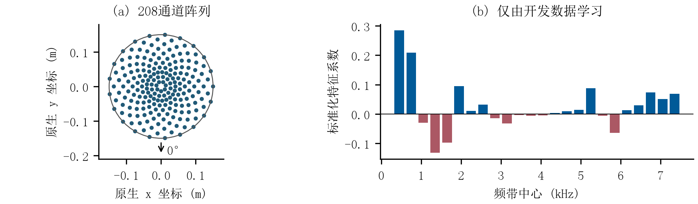
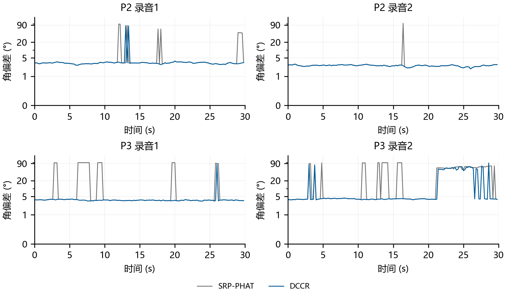

# 基于方向条件相干谱排序的无人机声学探测与测向

第一作者 Ju Luo

计算机科学与技术学院

南京航空航天大学

中国 南京

ytxlj12345@163.com

第二作者 Yuqian Zhou*

计算机科学与技术学院

南京航空航天大学

中国 南京

zhouyuqian@nuaa.edu.cn

摘要—相干背景声源可能主导声学空间图并掩盖无人机方向。本文提出方向条件相干谱排序方法，以24个相干频带特征和类别平衡岭回归对四个导向响应功率候选评分。208通道阵列录音按采集组划分：100 m用于方法开发，150 m和200 m用于保留评价。在600个无人机观测窗上，相对于标称参考方向的平均偏差由相位变换基线的14.78°降至6.97°；检出率为85.7%，200个背景窗上的虚警率为1.5%。共用检测器时，检出且定位偏差不超过10°的比例由76.5%升至85.5%。收益主要体现为大角度错误减少。证据限于单一机型、单日采集、标称静态参考、相关观测窗及本地背景标定。

关键词—无人机声学，麦克风阵列，到达方向，空间相干性，候选方向排序

## 引言

被动声学感知需要在噪声环境中检出无人机（unmanned aerial vehicle，UAV）辐射声并估计其方向，低信噪比会增加定位难度[1]。广义互相关用于估计麦克风对时延[2]，导向响应功率（steered response power，SRP）则在候选方向上汇总相关证据[3]、[4]。相位变换（phase transform，PHAT）强调相位一致性，因此相干非目标声源也可能主导空间响应。已有SRP扩展改善了频谱可靠性与空间搜索[4]，但将整幅空间图乘以相同的正检测权重，不会改变其最大值方向。

本文提出方向条件相干谱排序（direction-conditioned coherence ranking，DCCR），利用方向相干谱对四个SRP-PHAT候选排序。训练包含来自同一无人机观测的竞争方向，其背景和整体增益相同。本文贡献在于以既有阵列运算实现候选方向条件下的声源关联。通过共用检测器的比较，区分方向选择变化与报警决策变化的影响。

实际问题是声学阵列选出的方向是否属于无人机。较强的空间峰说明观测与某种传播时延模式一致，却不能单独确定声源类别。反之，由多麦克风平均频谱得到的报警，也不能指出应报告哪个空间峰。DCCR在每个候选方向分别评价声学证据，再以最高候选评分进行检测，从而把这两项决策联系起来。

## 相关研究

基于信噪比加权的波束形成与粒子跟踪[5]、PHAT-β部分频谱白化[6]及采用空间分离辅助麦克风的SRP[7]，分别在相应条件下处理噪声与混响问题。无人机方法利用旋翼谐波[8]，或将合成信号与神经定位相结合[9]。DCCR采用固定频带和紧凑线性模型，本文未与这些经过训练的神经系统直接比较。DDL将音频与飞行日志位置同步[10]，UaVirBASE则记录实测静态配置[11]。本文录音支持相对于标称静态方向的比较，但缺乏用于跟踪评价的同步轨迹。

旋翼辐射声包含谐波成分，其间隔与桨叶转速及叶片数量有关[8]。除宽带声级外，这为声学检测提供了与声源有关的线索。DCCR不显式估计旋翼转速或谐波间隔，而是以24个频带表示空间相干声的频率分布，并从开发录音中学习。这使同一表征能够用于声源检测和方向选择；其能否迁移至其他旋翼配置，仍需实测检验。

## 信号模型与方向特征

### 阵列与频谱估计

设麦克风位置为rm，远场单位方向为u，接收信号近似为

$$ x_m(t)=a_m s(t+\mathbf{r}_m^{T}\mathbf{u}/c)+v_m(t). $$ (1)

其中am为通道增益，vm包含背景与传感器噪声，声速c = 343 m/s。阵列孔径0.30 m远小于100–200 m标称距离。为消除平面阵列的镜像歧义，搜索限定于上半球。方位角a从原生负y方向顺时针计量，俯仰角e相对于阵列平面定义：

$$ \mathbf{u}(a,e)=(-\cos e\sin a,-\cos e\cos a,\sin e)^{T}. $$ (2)

阵列孔径将麦克风间的传播时延限制在约0.30/343 = 0.875 ms以内，相当于16 kHz采样率下的14个采样点。因此，时延插值可以减小数值量化误差，却不能消除传感器位置、通道相位或声速的不确定性。在分析频带内，波长从300 Hz处的约1.14 m变化到7500 Hz处的约0.046 m。低频在阵列孔径内产生的相位差较小，而高频对单个麦克风对可能产生有歧义的相位模式[4]。结合多个基线与频率，可提供互补的方向证据。远场模型估计方位角和俯仰角，不提供独立的距离测量。

每个200 ms观测窗按通道去均值，并通过抗混叠多相滤波由48 kHz重采样至16 kHz。512点周期Hann窗和256点帧移产生L = 11个去均值傅里叶帧，分析范围为300–7500 Hz。设Xm(l,k)为第l帧、第k频点的频谱，则平均互谱与自谱为

$$ R_{ij}(k)=L^{-1}\sum_{l=1}^{L}X_i(l,k)X_j(l,k)^{*},\qquad P_i(k)=R_{ii}(k). $$ (3)

相干归一化谱与PHAT谱分别为

$$ C_{ij}(k)=\frac{R_{ij}(k)}{\max(\sqrt{P_i(k)P_j(k)},\epsilon)},\qquad Q_{ij}(k)=\frac{R_{ij}(k)}{\max(|R_{ij}(k)|,\epsilon)}. $$ (4)

数值下限为带内平均通道功率的10⁻¹²倍，且不低于10⁻³⁰。先平均后归一化，避免单帧相干幅值恒为1。所有方法共用覆盖208通道的1124个通道对：按模208的索引偏移17、35、53、71、89和103构造，去重并保留基线不小于0.06 m的通道对。

这两种归一化的区别对无人机声学感知十分重要。未触及数值下限时，PHAT将非零互谱的幅值归一为1，仅保留相位，其中也包括通道间一致性较弱的频点。相干归一化还保留一致性的强弱，使弱相干分量对方向特征的贡献减小。若仅使用一个傅里叶帧，未触及下限时归一化互谱的幅值将恒为1；先平均互谱与自谱，才能使幅值包含有效信息。不过，相干干扰源也可能产生较大的相干值。因此，仅凭相干性不足以识别无人机，需要进一步学习不同频带之间的判别关系。

### 候选方向与相干特征

对于通道对集合P和频点集合F，未归一化的PHAT响应为

$$ B(\mathbf{u})=\sum_{(i,j)\in\mathcal{P}}\sum_{k\in\mathcal{F}}\operatorname{Re}\{Q_{ij}(k)e^{-j2\pi f_k(\mathbf{r}_i-\mathbf{r}_j)^{T}\mathbf{u}/c}\}. $$ (5)

水平方向余弦网格包含1257点，间隔0.05，按评分降序选取两两至少相隔12°的四个方向。各候选在±0.05邻域内以0.005间隔细化，再于方位角±1°、俯仰角±2°范围内以0.1°间隔细化。这些是数值搜索步长，不是物理精度保证。实现采用八倍插值逆FFT及线性时延查表，在固定比例因子下近似该响应。

将300–7500 Hz划分为24个相邻300 Hz频带，并包含末端频点。记第b个频带的频点集合为Fb，候选方向u的特征为

$$ f_b(\mathbf{u})=\frac{1}{|\mathcal{P}|\,|\mathcal{F}_b|}\sum_{(i,j)\in\mathcal{P}}\sum_{k\in\mathcal{F}_b}\operatorname{Re}\{C_{ij}(k)e^{-j2\pi f_k(\mathbf{r}_i-\mathbf{r}_j)^{T}\mathbf{u}/c}\}. $$ (6)

这些有符号特征保留随频率变化的方向支持程度。未触及数值下限时，正增益在归一化中抵消。回归模型仅接收24个频带值，不使用绝对功率、方向坐标、录音标识、距离或视频。图1给出了阵列几何和拟合系数。

当候选方向与入射声波一致时，导向因子补偿麦克风间的相位差，互谱实部倾向于同向累加。方向失配会留下残余相位，使频带内的贡献相互抵消。因此，即使两个峰具有相近的宽带PHAT响应，其相干谱也可能不同。式（8）利用了这一差异：拟合得到的正、负系数分别增强或抑制特定标准化频带响应。这些系数反映开发数据中的判别关系，并非通用的无人机辐射谱。与对整幅空间图乘以一个标量不同，随候选方向变化的评分能够改变最终选择的方向。

## 模型学习与联合推理

### 开发样本与正则化

P1包含300个无人机窗和100个背景窗，训练候选取自PHAT粗网格。参考导向波束和相对标称方向偏差不超过5°的候选为正例；偏差至少15°的候选及背景候选为负例；中间候选排除。推理不使用参考波束。1779个样本包括598个正例和1181个负例，其中781个为无人机观测中的错误方向。

图1 阵列几何及标准化相干频带的拟合系数，模型仅使用开发数据学习。

两个分组折各保留一整段无人机录音及开发背景中连续10 s的一半，同一观测窗的样本保持在同一折。这不构成跨独立背景录音的泛化检验。特征均值与标准差在训练折内按类别平衡权重估计，标准差下限为0.01。对N个样本的标准化特征zn和标签yn ∈ {−1,+1}，模型最小化

$$ \sum_{n=1}^{N}w_n(\boldsymbol{\beta}^{T}\mathbf{z}_n+b-y_n)^2+\lambda\|\boldsymbol{\beta}\|_2^2. $$ (7)

其中β为系数向量，b为截距。各类别权重之和为N/2，截距不正则化。平衡验证平方误差从{0.1，1，10，100}中选择λ = 100，再以全部开发样本拟合。消融模型仅去除781个错误方向负例，按相同分折选定λ = 10，其余推理过程不变。

### 方向选择与标定

对四个由音频产生的候选，以训练特征均值μ和标准差σ计算

$$ s_q=\boldsymbol{\beta}^{T}[(\mathbf{f}(\mathbf{u}_q)-\boldsymbol{\mu})/\boldsymbol{\sigma}]+b,\qquad q^{*}=\operatorname{argmax}_{q}s_q. $$ (8)

所选方向和检测分数分别为uq*及sq*。该分数为回归输出，而非后验概率。各方法使用每个测试组内相同的25个背景窗标定，其时段与评价窗不重叠。标称上尾水平为0.05时，顺序统计量秩ceil(26 × 0.95)为25；评分须严格大于标定最大值才判为检出。时间相关与非平稳性使其不具有正式的5%虚警保证。所有无人机窗均估计方向，包括漏检窗；联合成功另要求检出且偏差≤10°。

因此，推理分为两项决策。首先，即使所有候选都与背景相似，也仍由四个评分中的最大值选择一个方向。其次，通过与标定阈值比较，判断该方向是否伴随无人机报警。标定对象是最高候选评分，与推理实际使用的量一致；若对单个候选评分进行标定，则对应另一种决策规则。未通过检测的观测仍计入全部观测窗的角偏差统计，但不计为联合检测与测向成功。这样可避免将漏检窗中的准确方向误计为成功的无人机监测。

## 实测实验

### 录音与评价划分

本文使用第4届“声华杯”声学技术大赛提供的录音：2026年5月25日，朝向上方的CRY8501/SonoCam Pi阵列采集DJI Air 3S声信号[12]。各采集组包含两段无人机录音和一段背景录音（表I），每段208通道、48 kHz、16位PCM。九段录音总计273.75 s。每段录音内各通道样本数一致，1872个WAV文件均无样本达到PCM边界，但这不独立验证相位或时钟标定。标称方向来自采集示意图，缺乏用于量化悬停位移及参考不确定性的同步轨迹。视频既不输入估计器，也不替代真值。

表I 录音分组及标称方向，各组含两段无人机录音和一段背景录音。

| 分组 | 距离 | 方位角 录音1 / 录音2 | 俯仰角 | 用途 |
| --- | --- | --- | --- | --- |
| P1 | 100 m | 225.00° / 251.50° | 88.3° | 方法开发 |
| P2 | 150 m | 97.17° / 92.41° | 60.0° | 保留评价 |
| P3 | 200 m | 131.88° / 135.00° | 66.4° | 保留评价 |

每段无人机录音使用前30 s；背景的[0,5)、[5,10)和[10,30) s分别用于谱扣除参考、阈值标定和负例评价。P2/P3提供600个无人机窗和200个背景窗，另有50个标定窗。P1仅用于开发。本地背景标定是明确的运行前提。

### 比较方法与指标

基线共用几何、通道对、频带和搜索过程：SRP-PHAT；使用Cij的平滑相干变换（smoothed coherence transform，SCOT）SRP；以及以Qij clip((L|Cij|²−1)/(L−1),0,1)加权的相干PHAT。最后一项为有限快拍启发式，在重叠帧下不是无偏估计。背景扣除基线由当前与参考功率比的中位数估计通道增益，扣除缩放后的背景互谱，再由残余相干性及超额功率可靠性加权残余相位。代码给出完整运算，该基线并非文献[5]的复现。

分别使用各方法自己的标定检测器及共用的DCCR检测器评价方向结果；前者的实际虚警率不必相同。候选理想选择仅在推理结束后使用参考标签计算。对于估计与标称参考单位向量，角偏差为

$$ e_{\mathrm{ang}}=\frac{180}{\pi}\arccos[\operatorname{clip}(\widehat{\mathbf{u}}^{T}\mathbf{u}_{\mathrm{ref}},-1,1)]. $$ (9)

定位统计包含全部600个无人机窗；检出率（TPR）和虚警率（FPR）分别使用无人机窗和背景窗。800个观测窗存在时间相关性，不能视为独立试验，故采用描述性统计并列出四段录音的配对差值。代码、模型和输入哈希在保留评价前冻结。计时环境为Intel Core i7-12700KF、Python 3.12.14、NumPy 2.2.6和SciPy 1.15.3，数值库请求单线程。计时包含共用前端开销，排除文件读写，并非隔离基准测试。

## 结果

### 定位结果

DCCR平均偏差由SRP-PHAT的14.78°降至6.97°，按未四舍五入数据计算的降幅为7.82°；中位数为3.47°，95百分位为54.16°，10°以内比例为94.0%（表II）。

四段无人机录音的平均偏差均有所下降。P2录音1和录音2的PHAT/DCCR均值分别为6.95°/4.28°和3.23°/2.55°；P3则分别为17.32°/4.16°和31.62°/16.87°。四舍五入前计算的配对降幅依次为2.67°、0.68°、13.16°和14.76°。P3降幅较大，反映这些录音中存在更多可纠正的竞争峰错误。这并不意味着性能随距离增加而提高，因为距离、方向与声学条件同时变化。候选理想选择的均值为6.44°，10°以内比例为94.3%；这一事后参考辅助诊断反映候选覆盖，并非实际估计器输出。

表II 全部600个保留无人机窗相对于标称方向的偏差，包含漏检窗。

| 方法 | 均值 ° | 中位数 ° | 95分位 ° | ≤5° % | ≤10° % |
| --- | --- | --- | --- | --- | --- |
| SRP-PHAT | 14.78 | 3.49 | 96.87 | 84.8 | 84.8 |
| SCOT-SRP | 15.35 | 3.46 | 96.87 | 84.0 | 84.0 |
| 相干性加权PHAT | 18.46 | 3.43 | 95.78 | 80.0 | 80.0 |
| 背景互谱扣除 | 12.19 | 3.51 | 71.83 | 87.2 | 87.2 |
| DCCR无困难负例 | 6.97 | 3.47 | 54.16 | 94.0 | 94.0 |
| DCCR | 6.97 | 3.47 | 54.16 | 94.0 | 94.0 |

### 检测与消融

DCCR检出514/600窗（85.7%），虚警3/200窗（1.5%），见表III。P2/P3检出率分别为83.0%/88.3%，虚警率为0.0%/3.0%。标称5%标定水平不等于实际虚警率。

表III 各方法独立标定后的检测与联合定位结果，使用600个无人机窗和200个背景窗。

| 方法 | 检出数 / 600 | 虚警数 / 200 | 检出率 % | 虚警率 % | 联合 ≤10° % |
| --- | --- | --- | --- | --- | --- |
| SRP-PHAT | 148 | 1 | 24.7 | 0.5 | 19.2 |
| SCOT-SRP | 61 | 1 | 10.2 | 0.5 | 5.0 |
| 相干性加权PHAT | 39 | 1 | 6.5 | 0.5 | 1.0 |
| 背景互谱扣除 | 41 | 1 | 6.8 | 0.5 | 0.2 |
| DCCR无困难负例 | 473 | 3 | 78.8 | 1.5 | 78.8 |
| DCCR | 514 | 3 | 85.7 | 1.5 | 85.5 |

固定DCCR检测门控后，联合成功率由PHAT方向的76.5%升至DCCR的85.5%。两者均以全部600个无人机窗为分母，并共用514个检出窗；9.0个百分点的差别来自方向选择。

按观测窗数量计算，共用门控时PHAT和DCCR分别有459个和513个成功方向，在报警集合不变的条件下净增54个成功观测。该配对比较将声源关联的影响与阈值选择分离。表III中独立标定的检测结果回答的是另一问题，即各完整流程在自身实测工作点上的表现。由于基线的虚警率为0.5%，而DCCR为1.5%，仅凭检出率差异不能证明等虚警率下的优越性。

去除困难负例后，平均偏差四舍五入后仍为6.97°，检出率为78.8%，虚警率为1.5%。完整模型在相同虚警数下多检出41窗。仅三个无人机窗的所选方向不同，且两模型在这些窗上的偏差均超过10°。该消融支持当前工作点的检测收益，未显示额外定位增益。

DCCR每窗计算时间中位数/95百分位为414.9/588.7 ms，PHAT为227.9/331.3 ms，另需200 ms采集时间。四候选细化及特征计算增加开销；当前串行实现不能维持每秒五窗，尚未证明实时运行能力。

图2展示相同观测窗的逐窗偏差，未采用平滑或跟踪。曲线有助于区分孤立的峰选择失败与P3录音2中更持续的错误。

图2 四段保留无人机录音的逐窗偏差。角度轴在1°以上采用对数尺度；未使用时间平滑或跟踪。

## 讨论

平均偏差下降主要源于大角度错误减少：中位数由3.49°变为3.47°，95百分位由96.87°降至54.16°。偏差超过10°的无人机窗由PHAT的91个降至DCCR的36个。剩余36个失败窗中，34个没有10°以内候选，33个来自P3录音2。因此，仅有两个失败窗存在满足容差的候选，却未被排序器选中。这区分了候选覆盖与排序质量，也解释了DCCR与候选理想选择之间的差距较小。仅改进评分无法恢复四个候选中均不存在的无人机方向；扩大候选搜索范围需要新的方法开发及计算开销研究。

存储背景谱与当前背景的时间失配可能限制直接扣除的效果。DCCR避免对这些频谱做扣除，但仍使用背景录音标定报警阈值。未触及数值下限时，归一化可消除正通道增益因子，却不能消除相位失配、传播变化或无人机频谱差异。因此，实际部署需要验证通道同步、麦克风几何、阵列朝向及适当的声速模型。本数据集中通道文件长度一致且不存在削波，只能说明基本录音完整性，不能验证上述标定属性。

P2与P3的观测也说明，检出率不能直接解释为探测距离曲线。尽管P3的标称距离更远，DCCR在P2和P3的检出率仍分别为83.0%和88.3%。各组背景不同，使用各自的阈值，组间也未控制无人机朝向和辐射声级。因此，这些数据支持在已记录位置上的方法比较，但不能据此确定最大探测距离，也不能建立性能随距离单调变化的关系。

证据来自单机型、单日及具有本地标定的六段保留录音，并非800次独立现场试验。标称静态参考无法分离悬停运动、朝向误差和相位失配。现有负例未穷尽易混淆机械声和同时声源，有符号频带评分也不是无人机身份概率。距离估计、身份识别、多无人机分离及跟踪仍不在评价范围内。更广泛的验证需要新的开发数据及具有同步参考轨迹的独立录音。实测处理耗时也尚未验证实时实现；计算优化应与其对候选覆盖和检测性能的影响一并评估。

## 结论

DCCR通过24频带相干特征对四个方向排序，使保留录音平均标称方向偏差由14.78°降至6.97°，共用门控联合成功率由76.5%升至85.5%。收益主要来自大角度错误减少；困难负例消融仅支持所测工作点的检测改善。泛化验证需覆盖更多机型和采集时段，并采用同步参考轨迹。

## 致谢

本研究得到国家自然科学基金（编号U25A20427）的部分资助。

## 参考文献

[1] P. Chen, Y. Chen, and W. Wang, "Review for UAV Acoustic Positioning," Journal of South China University of Technology (Natural Science Edition), vol. 50, no. 12, pp. 109–123 (in Chinese), 2022. doi: 10.12141/j.issn.1000-565X.220277.

[2] C. H. Knapp and G. C. Carter, "The generalized correlation method for estimation of time delay," IEEE Transactions on Acoustics, Speech, and Signal Processing, vol. 24, no. 4, pp. 320–327, 1976. doi: 10.1109/TASSP.1976.1162830.

[3] J. H. DiBiase, H. F. Silverman, and M. S. Brandstein, "Robust Localization in Reverberant Rooms," in Microphone Arrays: Signal Processing Techniques and Applications, M. Brandstein and D. Ward, Eds. Berlin, Germany: Springer, ch. 8, pp. 157–180, 2001. doi: 10.1007/978-3-662-04619-7_8.

[4] E. Grinstein et al., "Steered Response Power for Sound Source Localization: a tutorial review," EURASIP Journal on Audio, Speech, and Music Processing, vol. 2024, Art. no. 59, 2024. doi: 10.1186/s13636-024-00377-z.

[5] J.-M. Valin, F. Michaud, and J. Rouat, "Robust localization and tracking of simultaneous moving sound sources using beamforming and particle filtering," Robotics and Autonomous Systems, vol. 55, no. 3, pp. 216–228, 2007. doi: 10.1016/j.robot.2006.08.004.

[6] K. D. Donohue, J. Hannemann, and H. G. Dietz, "Performance of phase transform for detecting sound sources with microphone arrays in reverberant and noisy environments," Signal Processing, vol. 87, no. 7, pp. 1677–1691, 2007. doi: 10.1016/j.sigpro.2007.01.013.

[7] K. Brümann and S. Doclo, "Steered Response Power-Based Direction-of-Arrival Estimation Exploiting an Auxiliary Microphone," in Proc. 32nd European Signal Processing Conference (EUSIPCO), pp. 917–921, 2024. doi: 10.23919/EUSIPCO63174.2024.10715232.

[8] S. Uluskan, "Precise acoustic drone localization and tracking via drone noise: Steered response power - phase transform around harmonics," International Journal of Aeroacoustics, vol. 23, nos. 5–6, pp. 558–577, 2024. doi: 10.1177/1475472X241259082.

[9] X. Yang, P. A. Naylor, S. Doclo, and J. Bitzer, "Neural Drone Localization Exploiting Signal Synthesis of Real-World Audio Data," in Proc. 33rd European Signal Processing Conference (EUSIPCO), pp. 256–260, 2025. doi: 10.23919/EUSIPCO63237.2025.11226465.

[10] S. Safavi, Ö. Çaylı, M. A. Safavi, B. Cook, and W. Wang, "DDL: A Dataset for Drone Detection and Localization From Multi-Channel Audio and a Deep Uncertainty-Aware Framework," in Proc. IEEE 35th International Workshop on Machine Learning for Signal Processing (MLSP), pp. 1–6, 2025. doi: 10.1109/MLSP62443.2025.11204285.

[11] G. Jekateryńczuk, R. Szadkowski, and Z. Piotrowski, "UaVirBASE: A Public-Access Unmanned Aerial Vehicle Sound Source Localization Dataset," Applied Sciences, vol. 15, no. 10, Art. no. 5378, 2025. doi: 10.3390/app15105378.

[12] "Shenghua Cup 2026, Attachment 4: Experimental Description," technical documentation accompanying the problem-1 data package of the 4th Shenghua Cup Acoustic Technology Competition, release package "0609 update," 2026 (in Chinese).
