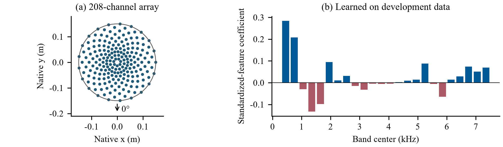
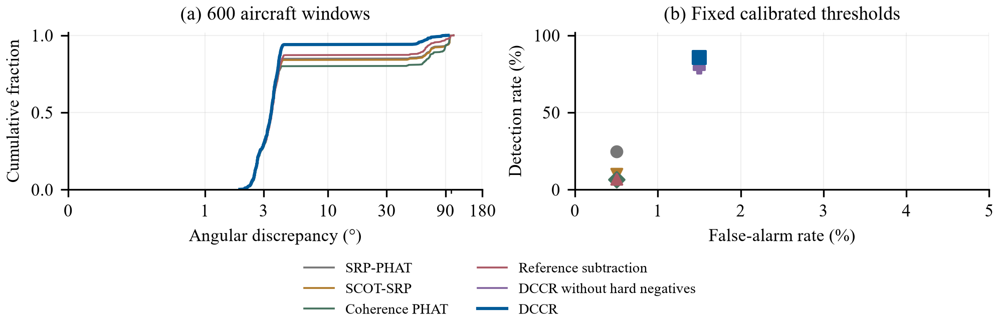
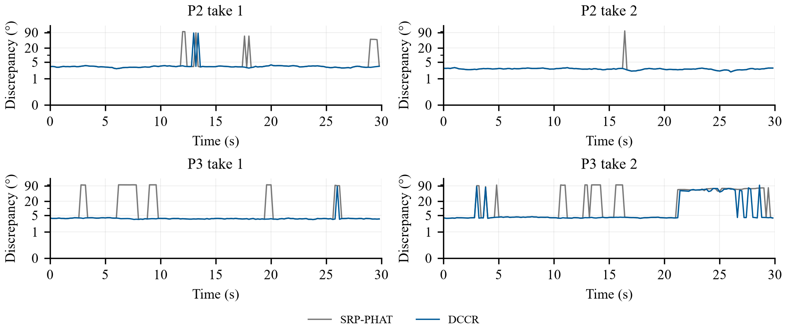

# Acoustic Detection and Direction Finding of Small Unmanned Aerial Vehicles Using Direction Conditioned Coherence Ranking

Ju Luo, Yuqian Zhou

Nanjing University of Aeronautics and Astronautics

Nanjing, China

## Abstract

Coherent background sources can dominate an acoustic spatial map and obscure the bearing of an unmanned aerial vehicle (UAV). This study proposes direction-conditioned coherence ranking (DCCR), which scores four steered-response-power candidates using 24 coherence-band features and class-balanced ridge regression. Recordings from a 208-channel array are partitioned by acquisition group: 100 m for development, and 150 and 200 m for held-out evaluation. Across 600 aircraft windows, the mean discrepancy from nominal reference directions decreases from {{PHAT_MEAN}}° to {{RANK_MEAN}}° relative to the phase-transform baseline. The detection rate is {{RANK_TPR}}%, with a {{RANK_FPR}}% false-alarm rate over 200 background windows. Under a shared detector, joint detection and localization within 10° increases from {{SHARED_PHAT_JOINT}}% to {{RANK_JOINT}}%. Gains primarily reflect fewer large direction errors. Evidence is limited to one aircraft model, one acquisition day, nominal static references, correlated windows, and local background calibration.

**Keywords** — UAV acoustics, microphone array, direction of arrival, spatial coherence, candidate ranking.

## I Introduction

Passive acoustic sensing must detect UAV emissions and associate them with a bearing in the presence of wind, vehicles and machinery [1]. Generalized cross-correlation and steered response power (SRP) combine intermicrophone delay evidence [2], [3]. The phase transform (PHAT) emphasizes phase alignment, so coherent non-UAV sources can also dominate the response. Existing SRP extensions improve spectral reliability and spatial search [4], but multiplying an entire spatial map by a positive detection weight leaves its maximizing direction unchanged.

DCCR instead ranks four SRP-PHAT proposals using directional coherence spectra. Training includes competing directions from the same aircraft observations, which share background and overall gain. The contribution is candidate-conditioned source association using established array operations. A shared-detector comparison separates changes in bearing selection from changes in alarm decisions.

## II Related Work

Noise-dependent beamforming and tracking [5], partial PHAT weighting [6], and auxiliary-microphone SRP in coherent noise [7] improve spatial reliability. UAV-specific approaches exploit rotor harmonics [8] or combine synthesized signals with neural localization [9]. DCCR uses fixed frequency bands and a compact linear model; no direct comparison with those trained neural systems is available. DDL [10] and UaVirBASE [11] provide multichannel UAV data and emphasize documented geometry and reference measurements. The present recordings support nominal static-bearing comparisons but lack synchronized trajectories for tracking evaluation.

## III Signal Model and Directional Representation

### A Array and spectral estimates

For microphone position r_m and far-field unit direction u, the received signal is approximated by

$$ x_m(t)=a_m s(t+\mathbf{r}_m^{T}\mathbf{u}/c)+v_m(t). $$ (1)

where a_m is a channel gain, v_m is background and sensor noise, and c = 343 m/s. The 0.30 m aperture is small relative to the 100–200 m nominal ranges. Search is restricted to the upper hemisphere to resolve planar-array mirror ambiguity. Clockwise azimuth a starts at native negative y; elevation e is above the array plane:

$$ \mathbf{u}(a,e)=(-\cos e\sin a,-\cos e\cos a,\sin e)^{T}. $$ (2)

Each 200 ms window is centered by channel and resampled from 48 to 16 kHz using an anti-aliasing polyphase filter. A 512-sample periodic Hann window and 256-sample hop yield L = 11 centered Fourier frames over 300–7500 Hz. Let X_m(l,k) denote the spectrum at frame l and bin k. The cross- and auto-spectra are

$$ R_{ij}(k)=L^{-1}\sum_{l=1}^{L}X_i(l,k)X_j(l,k)^{*},\qquad P_i(k)=R_{ii}(k). $$ (3)

The coherence-normalized and PHAT spectra are

$$ C_{ij}(k)=\frac{R_{ij}(k)}{\max(\sqrt{P_i(k)P_j(k)},\epsilon)},\qquad Q_{ij}(k)=\frac{R_{ij}(k)}{\max(|R_{ij}(k)|,\epsilon)}. $$ (4)

The floor is 10⁻¹² times mean in-band channel power, bounded below by 10⁻³⁰. Averaging precedes normalization to avoid unit-magnitude single-frame coherence. All methods use 1124 pairs spanning all 208 channels: index offsets 17, 35, 53, 71, 89 and 103 modulo 208, deduplicated and restricted to baselines of at least 0.06 m.

### B Proposals and coherence features

For microphone-pair set P and frequency-bin set F, an unnormalized PHAT response is

$$ B(\mathbf{u})=\sum_{(i,j)\in\mathcal{P}}\sum_{k\in\mathcal{F}}\operatorname{Re}\{Q_{ij}(k)e^{-j2\pi f_k(\mathbf{r}_i-\mathbf{r}_j)^{T}\mathbf{u}/c}\}. $$ (5)

A 1257-point horizontal direction-cosine grid with 0.05 spacing is searched in descending score order, retaining four directions separated by at least 12°. Each is refined over ±0.05 at 0.005 spacing, then over ±1° azimuth and ±2° elevation at 0.1° spacing. These are numerical search steps, not physical accuracy guarantees. Eightfold inverse-FFT interpolation and linear lag lookup approximate the response up to a constant scale.

The 300–7500 Hz range is divided into 24 adjacent 300 Hz bands, including the final bin. For the bin set F_b of band b, candidate u has feature

$$ f_b(\mathbf{u})=\frac{1}{|\mathcal{P}|\,|\mathcal{F}_b|}\sum_{(i,j)\in\mathcal{P}}\sum_{k\in\mathcal{F}_b}\operatorname{Re}\{C_{ij}(k)e^{-j2\pi f_k(\mathbf{r}_i-\mathbf{r}_j)^{T}\mathbf{u}/c}\}. $$ (6)

These signed features retain frequency-dependent directional support. Positive gains cancel away from the numerical floor. The regressor receives only the 24 band values; absolute power, bearing coordinates, recording identity, range and video are excluded. Fig. 1 shows the geometry and fitted coefficients.

## IV Learning and Joint Inference

### A Development and regularization

P1 supplies 300 aircraft and 100 background windows. Training proposals use the coarse PHAT grid. Reference-steered beams and proposals within 5° of the nominal direction are positive; proposals at least 15° away and background proposals are negative. Intermediate proposals are excluded. Reference beams are never used at inference. The 1779 examples comprise 598 positives and 1181 negatives, including 781 wrong aircraft directions.

Two grouped folds each hold out one aircraft recording and one contiguous 10 s half of the development background, keeping each window's examples together. This does not test transfer across independent background recordings. Class-balanced feature means and standard deviations are fitted within each fold, with a standard-deviation floor of 0.01. For N examples with standardized features z_n and labels y_n ∈ {−1,+1}, the model minimizes

$$ \sum_{n=1}^{N}w_n(\boldsymbol{\beta}^{T}\mathbf{z}_n+b-y_n)^2+\lambda\|\boldsymbol{\beta}\|_2^2. $$ (7)

The coefficient vector is β and the intercept is b. Each class has total weight N/2; b is unpenalized. Balanced validation squared error selects λ = 100 from {0.1, 1, 10, 100}, followed by refitting on all development examples. Removing the 781 wrong-direction negatives gives the ablation model, which selects λ = 10 with the same folds and otherwise unchanged inference.

### B Selection and calibration

For the four audio-generated candidates, with training feature means μ and standard deviations σ,

$$ s_q=\boldsymbol{\beta}^{T}[(\mathbf{f}(\mathbf{u}_q)-\boldsymbol{\mu})/\boldsymbol{\sigma}]+b,\qquad q^{*}=\operatorname{argmax}_{q}s_q. $$ (8)

The selected direction and detection score are u_q* and s_q*. Scores are regression outputs, not posterior probabilities. Each method uses the same 25 background windows per test group, temporally disjoint from evaluation windows. At nominal upper-tail level 0.05, the order-statistic rank ceil(26 × 0.95) is 25; detection requires a score strictly above the calibration maximum. Correlation and nonstationarity preclude a formal 5% false-alarm guarantee. All aircraft windows receive bearings, including missed detections; joint success additionally requires detection and discrepancy ≤10°.

## V Field Experiment

### A Recordings and evaluation split

An upward-facing CRY8501/SonoCam Pi array recorded a DJI Air 3S on 25 May 2026 [12]. Each acquisition group supplies two aircraft recordings and one background recording (Table I), with 208 channels at 48 kHz, 16-bit PCM. The nine recordings total 273.75 s. Channel sample counts agree within each recording, and no sample reaches the PCM limits across 1872 WAV files; this does not independently verify phase or clock calibration. Nominal bearings come from acquisition diagrams, without synchronized trajectories to quantify hovering displacement or reference uncertainty. Videos are not estimator inputs or ground truth.

**Table I. Recording groups and nominal directions; two aircraft takes and one background recording per group.**

| Group | Nominal range | Azimuth take 1 / take 2 | Elevation | Role |
|---|---|---|---|---|
| P1 | 100 m | 225.00° / 251.50° | 88.3° | Development |
| P2 | 150 m | 97.17° / 92.41° | 60.0° | Held-out evaluation |
| P3 | 200 m | 131.88° / 135.00° | 66.4° | Held-out evaluation |

The first 30 s of each aircraft take is used. Background intervals [0,5), [5,10) and [10,30) s provide subtraction references, threshold calibration and negative evaluation, respectively. P2/P3 contribute 600 aircraft and 200 background windows, plus 50 separate calibration windows. P1 is development only. Local background calibration is an explicit operating assumption.

### B Comparisons and measures

Baselines share geometry, pairs, frequency band and search: SRP-PHAT; smoothed coherence transform (SCOT)-SRP using C_ij; and coherence-weighted PHAT using Q_ij clip((L|C_ij|²−1)/(L−1),0,1). The last weight is a finite-snapshot heuristic, not an unbiased estimate under overlapping frames. A reference-subtraction baseline estimates per-channel gain from median current-to-reference power ratios, subtracts the scaled background cross-spectrum, and weights residual phase by residual coherence and excess-power reliability. Its operations are specified in the code; it is not a reproduction of [5].

Directions are evaluated under each method's calibrated detector and under a shared DCCR detector. The former operating points need not have equal false-alarm rates. Candidate-oracle selection uses reference labels only after inference. For estimated and nominal reference unit vectors,

$$ e_{\mathrm{ang}}=\frac{180}{\pi}\arccos[\operatorname{clip}(\widehat{\mathbf{u}}^{T}\mathbf{u}_{\mathrm{ref}},-1,1)]. $$ (9)

Localization includes all 600 aircraft windows. The true-positive rate (TPR) and false-positive rate (FPR) use aircraft and background windows, respectively. Temporal dependence precludes treating the 800 windows as independent trials; results are descriptive and include four recording-level paired differences. Code, model and input hashes were frozen before held-out execution. Runtime uses an Intel Core i7-12700KF, Python 3.12.14, NumPy 2.2.6 and SciPy 1.15.3, with numerical threads requested as one. Timings include shared front-end overhead, exclude file I/O, and are not an isolated benchmark.

## VI Results

### A Localization

{{LOCALIZATION_RESULTS}}

**Table II. Discrepancies from nominal bearings for all 600 held-out aircraft windows, including missed detections.**

{{LOCALIZATION_TABLE}}

{{RECORDING_RESULTS}}

**Table III. Recording-mean discrepancies. Positive PHAT-minus-DCCR differences indicate improvement and are calculated before rounding.**

{{RECORDING_TABLE}}

Fig. 2 summarizes error distributions and detector operating points.

### B Detection and ablation

{{DETECTION_RESULTS}}

**Table IV. Detection and joint localization with each method's calibrated threshold; TPR uses 600 aircraft windows and FPR uses 200 background windows.**

{{DETECTION_TABLE}}

{{JOINT_RESULTS}}

{{ABLATION_RESULTS}}

{{TIMING_RESULTS}}

Fig. 3 compares corresponding observations without smoothing or tracking.

## VII Discussion

The lower mean discrepancy primarily reflects fewer large errors: the median changes from 3.49° to 3.47°, whereas the 95th percentile decreases from 96.87° to 54.16°. Among the 36 DCCR windows exceeding 10°, 34 lack a candidate within 10° and 33 belong to P3 take 2. Candidate coverage thus limits most remaining large errors; ranking cannot recover a direction absent from the proposal set.

Temporal mismatch between stored and current background spectra may limit direct subtraction. DCCR avoids that subtraction but remains sensitive to aircraft, propagation and sensor changes. Evidence comes from one aircraft model, one day and six held-out recordings with local calibration, not 800 independent field trials. Nominal static references cannot separate hovering motion, orientation error and phase mismatch. Recorded negatives do not exhaust confusing machinery or simultaneous sources. Range estimation, identity recognition, multiple-UAV separation and tracking are outside the evaluated scope. Broader validation requires new development data and independent recordings with synchronized reference trajectories.

## VIII Conclusion

{{CONCLUSION}}

## References

{{REFERENCES}}
