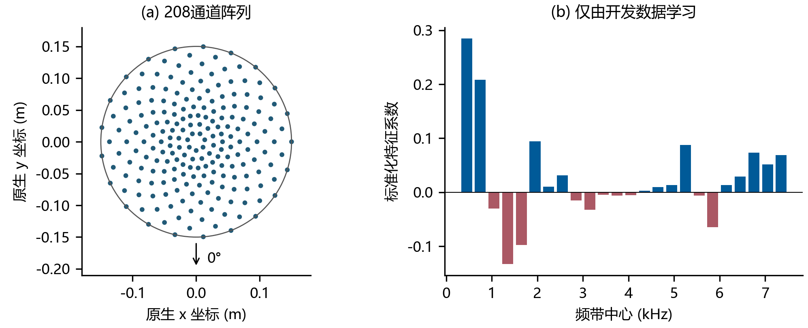
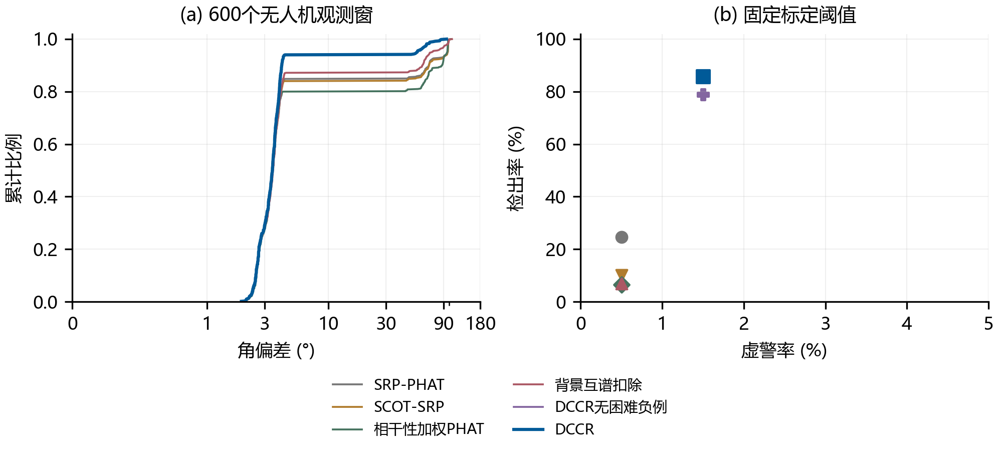
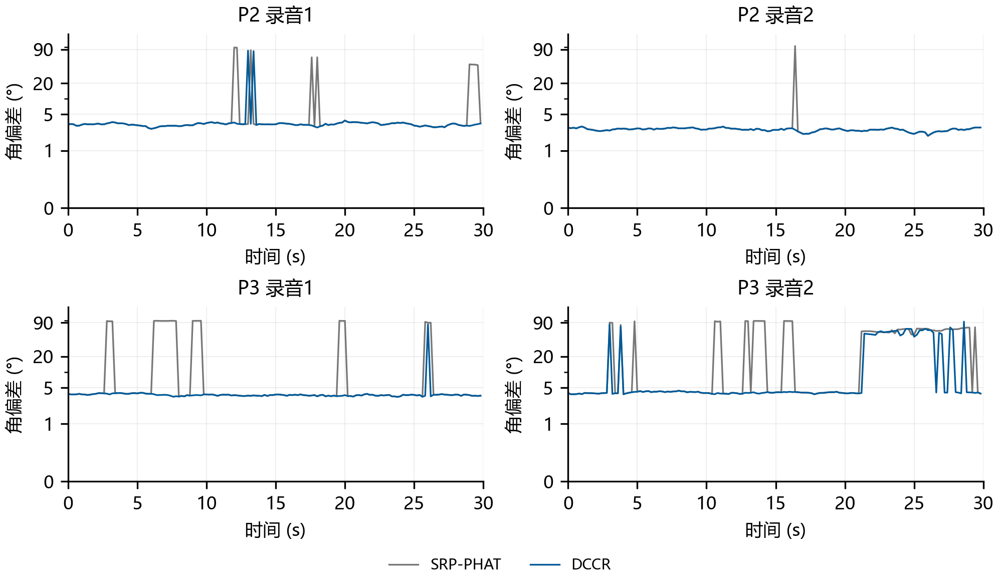

# 基于方向条件相干谱排序的小型无人机声学探测与测向

英文论文中文译稿

## 摘要

即使无人机声音可被接收，声学测向仍可能锁定具有较强相干性的背景声源。在选定最强空间峰之后再进行检测，不能消除这种声源关联错误。本文提出方向条件相干谱排序方法（direction-conditioned coherence ranking，DCCR）：首先利用相位变换导向响应功率（SRP-PHAT）生成四个候选方向，再根据学习得到的24频带方向相干谱特征对其排序。采用类别平衡岭回归模型，同时利用背景录音和无人机录音中的错误方向构造训练反例。特征不包含绝对声级和方向坐标。实验采用208通道平面阵列采集的DJI Air 3S真实室外录音。100 m位置用于方法开发，标称距离150 m和200 m的录音保留用于评价，并设置互不重叠的背景标定时段。在600个保留无人机观测窗上，相对于标称参考方向的平均球面角偏差由SRP-PHAT的14.78°变为DCCR的6.97°。采用独立标定的工作阈值时，DCCR的检出率为85.7%，在200个背景观测窗上的虚警率为1.5%。固定使用同一个DCCR检测门控，同时满足检出和10°以内定位的无人机观测窗比例由76.5%变为85.5%。这些结果反映四段无人机录音上的声源关联效果，各观测窗不构成相互独立的实验。标称静态参考、单一机型、单个采集日期以及测量组内背景标定共同限定了结论的适用范围。

**关键词** — 无人机声学，麦克风阵列，到达方向，SRP-PHAT，空间相干性，候选方向排序。

## I 引言

被动声学感知能够直接观测小型旋翼飞行器辐射的声音。其有效性取决于从环境声音中提取与飞行器有关的证据，并将这些证据关联到相应方向[1]。这是两个不同的问题。较强的空间峰仅说明某一成分与声源方向具有空间一致性，并不表明该声源就是无人机。因此，风、车辆、机械设备及其他相干背景既可能影响报警判断，也可能改变所选方向。

广义互相关和导向响应功率为融合麦克风间的时延信息提供了可解释的机制[2]、[3]。相位变换能够锐化空间响应，但也会使无人机能量较少的频点获得较大影响。已有SRP扩展研究涉及频谱可靠性、空间搜索和多声源处理[4]。另一个问题在于：无人机方向可能已经出现在空间图中，却不是最强峰。对整幅空间图乘以同一个正检测分数，不能改变其最大值所在位置。

本文采用紧凑监督模型处理这一关联环节。SRP-PHAT首先在不使用无人机标签或参考角度的情况下生成多个方向，再利用导向后的归一化互谱相干响应构造每个方向的频率特征。线性岭回归评分学习哪些特征对应无人机，同时与同一无人机录音中的错误方向进行对比。得分最高的候选同时给出方向和检测分数。该方法称为方向条件相干谱排序，即DCCR。

本文的贡献是在成熟阵列处理组件之上给出明确、可复现的声源关联机制，包括24维方向特征、同一录音内的困难负例以及仅依赖音频的候选搜索。保留实测数据上的比较对传统方向估计和排序后方向估计使用同一检测门控，从而单独考察关联作用。实验采用实测208通道录音，而非以合成声场替代实验证据。有限的采集多样性支持聚焦的算法比较，同时要求严格限定推广范围。

## II 相关研究

Knapp和Carter建立了用于时延估计的广义相关框架[2]。SRP将麦克风对的时延证据投影为空间搜索，仍是声学定位的重要方法[3]、[4]。PHAT、平滑相干变换（SCOT）归一化和可靠性加权在幅度信息与相位稳健性之间采用不同权衡。这些均为已有信号处理方法，不属于DCCR新提出的组成部分。

Valin等将噪声相关可靠性引入波束形成，并结合粒子滤波跟踪[5]。Donohue等研究了噪声和混响环境中的部分相位变换加权[6]。Brümann和Doclo分析了相干噪声对紧凑阵列SRP的影响，并研究辅助麦克风方案[7]。这些工作说明，有必要区分可靠的相干成分和属于无人机的成分。本文实现不使用辅助麦克风或粒子跟踪器。

面向无人机的研究利用了旋翼相关频谱结构。Uluskan研究了无人机谐波邻域的SRP[8]；Yang等研究了结合信号合成和真实无人机音频的神经网络定位[9]。DCCR采用固定频带，不估计桨叶通过频率。其模型规模针对现有开发录音设置，不据此推断其可替代在更大语料上训练的神经网络方法。DDL和UaVirBASE等数据集也体现了采集几何与定位参考信息的重要性[10]、[11]。本研究录音附带的标称示意图支持静态方向比较，但不足以开展轨迹级跟踪评价。

候选方向相关的频谱证据使DCCR区别于对单个SRP最大值附加观测窗级检测器。错误方向训练样本来自与正例相同的无人机音频，二者共享全局频谱、环境背景和录音增益，因此仅靠文件级背景或总体幅度无法区分。该设计不能排除所有数据集捷径，但使声源关联成为学习目标中的明确组成部分。

## III 信号模型与方向特征

### A 阵列与坐标模型

设第m个麦克风的位置为三维向量r_m。对于单位方向u上的远场声源，接收信号近似为

$$ x_m(t)=a_m s(t+\mathbf{r}_m^{T}\mathbf{u}/c)+v_m(t). $$ (1)

其中，c为声速，a_m为通道增益，v_m包含背景声音和传感器噪声。实现中取c = 343 m/s。阵列孔径为0.30 m，远小于100–200 m的标称声源距离，因此估计对象为方向而非距离。平面阵列在其平面两侧存在镜像歧义；由于无人机位于阵列上方，搜索域限定为上半球。

方位角a从设备参考标记出发沿顺时针方向增加，俯仰角e相对于阵列平面定义。在阵列几何文件的原生坐标中，零方位对应负y方向，90°对应负x方向，相应单位向量为

$$ \mathbf{u}(a,e)=(-\cos e\sin a,-\cos e\cos a,\sin e)^{T}. $$ (2)

导向计算直接使用物理几何，不采用相机显示中的像素到角度近似。接近天顶时，水平投影的微小变化即可引起较大的方位角变化，因此以球面角偏差作为主要定位指标。

### B 互谱估计

每个200 ms观测窗先按通道去均值，再通过带抗混叠滤波的多相重采样由48 kHz转换为16 kHz。采用512点周期Hann窗和256点帧移，在每个观测窗内得到11个短时傅里叶帧。每个短帧也进行去均值处理。分析频率范围为300–7500 Hz。设X_m(l,k)为第l个短帧的复频谱，平均互谱与自谱为

$$ R_{ij}(k)=L^{-1}\sum_{l=1}^{L}X_i(l,k)X_j(l,k)^{*},\qquad P_i(k)=R_{ii}(k). $$ (3)

复相干归一化谱与PHAT谱分别定义为

$$ C_{ij}(k)=\frac{R_{ij}(k)}{\max(\sqrt{P_i(k)P_j(k)},\epsilon)},\qquad Q_{ij}(k)=\frac{R_{ij}(k)}{\max(|R_{ij}(k)|,\epsilon)}. $$ (4)

数值下限取带内平均通道功率的10⁻¹²倍，且不低于10⁻³⁰。先平均后归一化，避免由单个外积计算相干性；后者在两个通道均非零时会恒得单位幅值。

全部208个通道均参与固定的1124个麦克风对。构造规则为对通道索引施加17、35、53、71、89和103的模208偏移，去重后保留基线长度不小于0.06 m的通道对。该规则只依赖通道顺序和几何位置。所有比较方法采用相同的通道对，因此不能将通道对减少带来的影响计为DCCR独有的精度增益。

### C 候选方向生成

对于通道对集合P和分析频率集合F，PHAT空间评分正比于

$$ B(\mathbf{u})=\sum_{(i,j)\in\mathcal{P}}\sum_{k\in\mathcal{F}}\operatorname{Re}\{Q_{ij}(k)e^{-j2\pi f_k(\mathbf{r}_i-\mathbf{r}_j)^{T}\mathbf{u}/c}\}. $$ (5)

其符号与式（1）一致：声音较早到达更接近声源的麦克风，形成正互谱相位，导向项将其抵消。粗搜索在水平方向余弦圆盘上以0.05间隔均匀采样，共得到1257个点；垂直分量取满足单位长度的非负平方根。保留得分最高且两两至少相隔12°的四个候选。随后在每个候选水平方向余弦的±0.05邻域内以0.005间隔细化，再以0.1°间隔进行局部角度细化，方位角和俯仰角邻域分别为±1°和±2°。0.1°仅为数值搜索步长，不代表实测物理精度达到0.1°。

实现使用八倍插值的逆FFT相关表及线性时延查表。五个已知上半球方向的确定性相位测试偏差均小于0.054°。这些测试检验符号和数值搜索，不用于证明实测参考标签的准确性。

### D 方向条件相干频带特征

将分析范围划分为24个相邻的300 Hz频带，并包含末端7500 Hz频点。候选方向u的第b个特征为

$$ f_b(\mathbf{u})=\frac{1}{|\mathcal{P}|\,|\mathcal{F}_b|}\sum_{(i,j)\in\mathcal{P}}\sum_{k\in\mathcal{F}_b}\operatorname{Re}\{C_{ij}(k)e^{-j2\pi f_k(\mathbf{r}_i-\mathbf{r}_j)^{T}\mathbf{u}/c}\}. $$ (6)

该有符号响应衡量各频率区域对特定方向的支持程度，保留随频率变化的相干结构，而不将全部频点压缩为一个宽带峰值。在未触及数值下限时，正通道增益在互谱与自谱归一化中抵消，因此共同幅度变化不改变该表示。对一个开发观测窗施加0.001、17和1000倍幅度增益，最终评分变化均小于1.1 × 10⁻⁷，所选方向不变。

模型只接收这24个数值，不接收方位角、俯仰角、距离、录音标识、绝对功率、相机图像或参考方向。几何信息通过物理导向运算进入处理链，而非作为学习得到的坐标先验。

## IV 模型学习与联合推理

### A 训练样本与困难负例

100 m开发位置的两段无人机录音提供正观测窗。每个观测窗的标称参考方向作为额外训练波束；与参考方向相差不超过5°的PHAT候选也标记为正例。偏差不小于15°的候选作为困难负例，两者之间的候选因监督歧义而排除。背景观测窗提供负候选。参考导向波束仅用于构造训练样本，绝不加入保留数据推理时的候选集合。

开发集包含300个无人机观测窗和100个背景观测窗，共形成1779个方向标注样本，其中正例598个、负例1181个。负例包含无人机观测窗中的781个错误方向和背景观测窗中的400个候选。模型选择时，同一观测窗的样本始终保持在同一折。两个分组折分别保留一整段无人机录音，以及开发背景录音中连续10 s的一半。由于两个背景时段来自同一录音，内部验证不构成跨独立背景录音的泛化检验。

### B 正则化排序模型

在每个训练折内采用类别平衡权重计算特征均值和标准差，并将标准差下限设为0.01。设z_n为标准化特征，y_n ∈ {−1,+1}，模型最小化

$$ \sum_{n=1}^{N}w_n(\boldsymbol{\beta}^{T}\mathbf{z}_n+b-y_n)^2+\lambda\|\boldsymbol{\beta}\|_2^2. $$ (7)

每一类别的权重之和均为N/2，截距不参与正则化。通过两个保留折上的类别平衡候选平方误差，在0.1、1、10和100中选择岭回归强度，最终选定100，并使用全部允许的开发样本重新拟合。模型输出是用于排序和阈值判断的回归分数，不是经过校准的后验概率。

困难负例消融模型仅去除无人机观测窗中的781个错误方向，保留相同特征、推理候选和标定规则，并通过相同分组程序独立选择岭回归强度10。该比较检验：训练时让模型接触同一音频中的竞争方向，是否有助于声源关联。

### C 推理与阈值标定

对于四个由音频生成并细化的候选方向，DCCR计算

$$ s_q=\boldsymbol{\beta}^{T}[(\mathbf{f}(\mathbf{u}_q)-\boldsymbol{\mu})/\boldsymbol{\sigma}]+b,\qquad q^{*}=\operatorname{argmax}_{q}s_q. $$ (8)

所选单位向量为u_q*，检测分数为s_q*。各方法在每个评价测量组内使用同一批25个背景观测窗独立标定阈值。当标称上尾水平α = 0.05时，顺序统计量秩ceil((25+1)(1−α))为25，只有评分严格大于标定分数最大值才判为检出，等于阈值时拒绝。这是一项经验工作点规则；存在时间相关和非平稳性的背景观测窗不能满足正式5%虚警保证所需的可交换性条件。

所有正观测窗均得到方向估计，包括被检测器拒绝的观测窗。因此，定位结果不会因排除困难的漏检观测而人为改善。联合成功另行定义为同时检出且角偏差不超过10°。

## V 实测实验

### A 录音与参考信息

声学数据于2026年5月25日使用水平放置、朝向上方的CRY8501/SonoCam Pi阵列和DJI Air 3S采集[12]。数据集包含九段录音，即三个位置各两段无人机录音和一段背景录音。每段录音包含208个同步采集通道文件，采样率48 kHz，格式为16位PCM。实际文件时长为30.30–30.50 s，总时长273.75 s。存储的麦克风极坐标给出最大半径0.1499944 m。全部1872个WAV文件的通道格式与样本长度已经核对，没有样本达到PCM削波边界。文件头一致并不等同于独立验证了麦克风相位标定或采样时钟偏差。

各通道存在不同的直流偏置，因此统一进行去均值处理。未根据定位结果事后排除通道。视频和设备成像输出既不输入估计器，也不替代方向真值。参考方位角和俯仰角来自表I所列采集示意图；未提供可量化其不确定性及录音内悬停位移的同步轨迹日志。因此，所报告误差应理解为相对于标称静态方向的偏差。

**表I 录音分组与标称方向。每组包含两段约30 s无人机录音及一段约30 s背景录音。**

| 分组 | 标称距离 | 录音1／录音2方位角 | 俯仰角 | 用途 |
|---|---|---|---|---|
| P1 | 100 m | 225.00° / 251.50° | 88.3° | 方法开发 |
| P2 | 150 m | 97.17° / 92.41° | 60.0° | 保留评价 |
| P3 | 200 m | 131.88° / 135.00° | 66.4° | 保留评价 |

各无人机录音均使用前30 s，统一排除较短尾段。每段背景录音的[0,5) s用于需要噪声参考的方法，[5,10) s用于检测标定，[10,30) s用于背景评价。主要评价共包含P2和P3的600个无人机观测窗、200个背景观测窗，另有50个独立划分的标定观测窗。P1结果仅属于开发诊断，不并入上述总数。短时本地背景标定数据的可获得性是明确的运行前提。

### B 基线方法与作用归因

主要基线为SRP-PHAT、使用式（4）中C_ij的SCOT-SRP，以及相干性加权PHAT。后者将Q_ij乘以clip((L|C_ij|²−1)/(L−1),0,1)。该项是有限快拍收缩启发式，在重叠Hann帧条件下不能视为严格无偏估计。所有方法采用相同几何、通道对、分析频带和搜索细化步骤。

另保留背景参考辅助方法作为对照。它由指定背景时段估计自谱与互谱，以当前和参考带内功率比的通道中位数进行增益对齐，扣除缩放后的背景互谱，并利用有界残余相干性和非负超额功率可靠性对残余相位加权。复现代码给出了全部运算。它是一种简化的谱扣除基线，不是对文献[5]自适应估计器的复现。其开发阶段表现不佳，因此保留该比较，以检验而非预设背景扣除的收益。

无困难负例DCCR模型在评价时使用完全相同的候选特征。除了比较各方法自己的检测器，还将完整DCCR检测判断固定应用于每种基线方向，以区分声源关联变化和报警阈值变化。候选集合中的最小方向偏差仅在推理结束后作为理想选择诊断计算，不作为估计器输出。

### C 指标与复现

估计和参考单位向量之间的角偏差为

$$ e_{\mathrm{ang}}=\frac{180}{\pi}\arccos[\operatorname{clip}(\widehat{\mathbf{u}}^{T}\mathbf{u}_{\mathrm{ref}},-1,1)]. $$ (9)

定位指标包括均值、中位数、95百分位，以及5°和10°以内的比例。检出率与虚警率分别由指定无人机和背景观测窗计算。录音时长一致，使汇总无人机均值对四段录音等权。相邻观测窗仍存在时间相关性，因此按观测窗计算二项区间或独立观测窗bootstrap会夸大有效样本量。主要比较采用描述性统计，并明确列出四段录音的配对差值。

在处理保留数据前冻结代码、模型、协议、特征缓存和输入清单哈希；读取保留结果后不修订模型。验证覆盖阵列相位约定、缓存特征重算、岭回归方程残差、幅度不变性、阈值不等式、完整配对和统计重算。运行时间在Intel Core i7-12700KF工作站上使用Python 3.12.14、NumPy 2.2.6及SciPy 1.15.3测量，数值计算库请求使用单线程。墙钟时间采集于完整比较运行过程，不属于隔离的计时基准实验。计时不包含文件读取，200 ms数据采集窗还需另计。基线计时保守地包含共享频谱权重构造器开销，无困难负例模型的计时也包含共用候选准备步骤，应视为该独立实现的计算上界。

## VI 结果

### A 方向估计与声源关联

DCCR的平均球面角偏差为6.97°，SRP-PHAT为14.78°，配对平均差值（PHAT减DCCR）为+7.82°。DCCR的中位数和95百分位分别为3.47°和54.16°，10°以内比例为94.0%。SCOT-SRP和相干性加权PHAT的平均偏差分别为15.35°和18.46°。全部定位统计见表II。

**表II 全部600个保留无人机观测窗相对于标称方向的定位偏差，包括被检测器拒绝的观测窗。**

| 方法 | 均值 ° | 中位数 ° | 95百分位 ° | ≤5° % | ≤10° % |
| --- | --- | --- | --- | --- | --- |
| SRP-PHAT | 14.78 | 3.49 | 96.87 | 84.8 | 84.8 |
| SCOT-SRP | 15.35 | 3.46 | 96.87 | 84.0 | 84.0 |
| 相干性加权PHAT | 18.46 | 3.43 | 95.78 | 80.0 | 80.0 |
| 背景互谱扣除 | 12.19 | 3.51 | 71.83 | 87.2 | 87.2 |
| DCCR无困难负例 | 6.97 | 3.47 | 54.16 | 94.0 | 94.0 |
| DCCR | 6.97 | 3.47 | 54.16 | 94.0 | 94.0 |

相对于SRP-PHAT，DCCR在四段无人机录音中的4段降低了平均偏差。各段配对差值为+0.68°至+14.76°，详见表III。四候选理想选择诊断的平均偏差为6.44°，10°以内比例为94.3%。该数值使用评价参考进行事后理想选择，只用于说明候选覆盖限制，不能当作可实现的推理成绩。

**表III 各保留无人机录音的平均角偏差。正差值表示相对于SRP-PHAT有所改善。**

| 录音 | SRP-PHAT ° | DCCR ° | 差值 ° |
| --- | --- | --- | --- |
| P2 take 1 | 6.95 | 4.28 | +2.67 |
| P2 take 2 | 3.23 | 2.55 | +0.68 |
| P3 take 1 | 17.32 | 4.16 | +13.16 |
| P3 take 2 | 31.62 | 16.87 | +14.76 |

### B 检测与共用门控比较

DCCR检出514/600个无人机观测窗，并在3/200个背景观测窗上产生虚警，对应85.7%检出率和1.5%虚警率。P2和P3的检出率分别为83.0%和88.3%，背景虚警率分别为0.0%和3.0%。这些组间结果体现固定经验阈值在不同观测时段上的实际行为，不能以标定规则中的5%代替测得的虚警率。

**表IV 保留数据上的检测及联合结果。检出率以600个无人机观测窗为分母，虚警率以200个背景观测窗为分母。各方法使用独立背景标定阈值。**

| 方法 | 检出数 | 虚警数 | 检出率 % | 虚警率 % | 联合成功 % |
| --- | --- | --- | --- | --- | --- |
| SRP-PHAT | 148 | 1 | 24.7 | 0.5 | 19.2 |
| SCOT-SRP | 61 | 1 | 10.2 | 0.5 | 5.0 |
| 相干性加权PHAT | 39 | 1 | 6.5 | 0.5 | 1.0 |
| 背景互谱扣除 | 41 | 1 | 6.8 | 0.5 | 0.2 |
| DCCR无困难负例 | 473 | 3 | 78.8 | 1.5 | 78.8 |
| DCCR | 514 | 3 | 85.7 | 1.5 | 85.5 |

固定使用完整DCCR检测门控时，SRP-PHAT方向的联合成功率为76.5%，DCCR方向为85.5%，差值为+9.0个百分点。两者采用相同的514个已检出正观测窗，差别来自方向选择。单独报告的600窗定位指标仍包含漏检观测。

### C 消融与计算开销

去除同一无人机录音中的错误方向训练反例后，平均偏差为6.97°，完整模型为6.97°，两者在所示精度下相同。消融模型的检出率为78.8%，虚警率为1.5%。完整模型多检出41个正观测窗，虚警数相同。两个模型只在3个正观测窗中选择不同方向，且这3个观测窗的偏差均超过10°。因此，困难负例的实测收益体现在当前标定工作点的检测上，而非方向精度；不能将其单独宣称为已验证的定位增益。

DCCR每窗计算时间的中位数和95百分位分别为414.9 ms和588.7 ms；SRP-PHAT对应为227.9 ms和331.3 ms。计时包括重采样和互谱前端，不包括文件读取，另需200 ms采集窗。四候选细化和方向特征计算增加了处理开销。当前串行实现在该工作站上也不能维持每秒5个观测窗的持续处理速率，因而不能据此声称实时运行。

## VII 讨论

排序框架改变了优化对象。PHAT寻找宽带相位一致性，DCCR则在每个候选方向上，将随频率变化的一致性与学习得到的无人机表示进行比较。同一无人机观测中的错误方向与正波束共享全局频谱、环境背景和录音增益。第VI节的共用检测器比较检验了排序机制，避免将不同报警判断产生的收益归于定位。困难负例消融支持其在所选工作点上的检测收益，但没有提供独立的方向精度增益。

平均偏差下降主要来自严重偏离标称方向的情况减少，汇总中位数仅由3.49°变为3.47°，95百分位仍为54.16°。P3录音2中仍有33/150个估计超过10°。全部正观测窗的36个10°以上偏差中，有34个本身就没有10°以内的候选。因此，相对于标称参考，剩余尾部偏差主要受候选覆盖限制。若无更精确的同步参考测量，不能区分其他较稳定估计中的小幅系统偏差，也不能分离无人机自身运动的影响。

实测实验也揭示了直接参考谱扣除的局限。较早采集的背景录音并不是后来无人机录音中的精确噪声实现，缩放其平均频谱不能重建变化中的车辆、风或其他瞬态。谱扣除可能衰减有效频点，或保留误导性的残余。DCCR不需要扣除假定与当前观测同时发生的背景波形，但学习到的频谱特征仍会受到机型、运行状态、传播和传感器响应变化的影响。

结论受到若干条件限制。首先，评价只包含一种机型、一个采集日期和两个保留位置；六段保留录音才是相应证据单位，800个测试观测窗不能形成800次独立现场试验。其次，标定背景来自相同测量组，因此不能据此推断模型无需标定即可迁移到新环境。第三，参考方向是标称静态值，悬停运动、方向注册、声速误差和麦克风相位失配均可能影响所报告偏差。第四，负例是已录制的背景，并未穷尽易混淆机械设备、其他飞行器或同时存在的多个声源。

DCCR还受到候选阶段覆盖率的限制。若SRP-PHAT未将有效无人机方向纳入四个候选，排序器无法恢复该方向。增加候选数量或使用多种空间前端可能改善覆盖率，但会改变计算量和训练分布。此类修改需要新的开发数据及新保留评价，不能在当前测试结果上事后调参。

该方法估计方向和经验性的声学存在评分，不估计距离、不认证飞行器身份、不分离多个同时存在的无人机，也不验证运动跟踪器。工作站计算时间同样不能确立嵌入式设备时延。在这些边界下，本文给出了具体结果：在固定协议下，通过真实多通道无人机录音比较了一种已实现的方向条件声源关联方法。

## VIII 结论

本文提出DCCR，将SRP-PHAT的四个候选方向与24频带方向相干谱的紧凑监督评分相结合。在保留的150 m和200 m实测录音上，平均标称方向偏差由SRP-PHAT的14.78°变为6.97°，检出率为85.7%，背景虚警率为1.5%。共用检测门控下，10°以内联合成功率由76.5%变为85.5%。该方法将声源关联落实为候选方向上的学习问题，并给出完整可复现实现。现有结果的适用范围仍受候选覆盖、标称参考精度、背景标定及单机型单日采集条件限制。

## 数据与代码可用性

复现材料包含阵列读取、训练与推理代码、冻结模型、开发选择记录、输入哈希、逐窗预测、候选分数，以及重建表格和图形的脚本。实测录音保留原始通道文件与采集文档，其分发适用原始提供方的条件，本文不声明无限制公开再分发许可。实测结果不包含合成观测。

## 参考文献

[1] P. Chen, Y. Chen, and W. Wang, "Review for UAV Acoustic Positioning," Journal of South China University of Technology (Natural Science Edition), vol. 50, no. 12, pp. 109–123 (in Chinese), 2022. [doi: 10.12141/j.issn.1000-565X.220277](https://doi.org/10.12141/j.issn.1000-565X.220277).

[2] Charles H. Knapp, G. Clifford Carter, "The generalized correlation method for estimation of time delay," IEEE Transactions on Acoustics, Speech, and Signal Processing, 24(4), 320–327, 1976. [doi: 10.1109/TASSP.1976.1162830](https://doi.org/10.1109/TASSP.1976.1162830).

[3] Joseph H. DiBiase, Harvey F. Silverman, Michael S. Brandstein, "Robust Localization in Reverberant Rooms," In Michael Brandstein and Darren Ward (eds.), Microphone Arrays: Signal Processing Techniques and Applications, Digital Signal Processing, Springer, Berlin, Heidelberg, Chapter 8, pp. 157–180, 2001. [doi: 10.1007/978-3-662-04619-7_8](https://doi.org/10.1007/978-3-662-04619-7_8).

[4] Eric Grinstein et al., "Steered Response Power for Sound Source Localization: a tutorial review," EURASIP Journal on Audio, Speech, and Music Processing, 2024, article 59, 2024. [doi: 10.1186/s13636-024-00377-z](https://doi.org/10.1186/s13636-024-00377-z).

[5] Jean-Marc Valin, François Michaud, Jean Rouat, "Robust localization and tracking of simultaneous moving sound sources using beamforming and particle filtering," Robotics and Autonomous Systems, 55(3), 216–228, 2007. [doi: 10.1016/j.robot.2006.08.004](https://doi.org/10.1016/j.robot.2006.08.004).

[6] Kevin D. Donohue, Jens Hannemann, Henry G. Dietz, "Performance of phase transform for detecting sound sources with microphone arrays in reverberant and noisy environments," Signal Processing, 87(7), 1677–1691, 2007. [doi: 10.1016/j.sigpro.2007.01.013](https://doi.org/10.1016/j.sigpro.2007.01.013).

[7] Klaus Brümann, Simon Doclo, "Steered Response Power-Based Direction-of-Arrival Estimation Exploiting an Auxiliary Microphone," 2024 32nd European Signal Processing Conference (EUSIPCO), 917–921, 2024. [doi: 10.23919/EUSIPCO63174.2024.10715232](https://doi.org/10.23919/EUSIPCO63174.2024.10715232).

[8] Seçkin Uluskan, "Precise acoustic drone localization and tracking via drone noise: Steered response power - phase transform around harmonics," International Journal of Aeroacoustics, 23(5–6), 558–577, 2024. [doi: 10.1177/1475472X241259082](https://doi.org/10.1177/1475472X241259082).

[9] Ximei Yang, Patrick A. Naylor, Simon Doclo, Joerg Bitzer, "Neural Drone Localization Exploiting Signal Synthesis of Real-World Audio Data," 2025 33rd European Signal Processing Conference (EUSIPCO), 256–260, 2025. [doi: 10.23919/EUSIPCO63237.2025.11226465](https://doi.org/10.23919/EUSIPCO63237.2025.11226465).

[10] Saeid Safavi, Özkan Çaylı, Mohammad Amin Safavi, Ben Cook, Wenwu Wang, "DDL: A Dataset for Drone Detection and Localization From Multi-Channel Audio and a Deep Uncertainty-Aware Framework," 2025 IEEE 35th International Workshop on Machine Learning for Signal Processing (MLSP), 1–6, 2025. [doi: 10.1109/MLSP62443.2025.11204285](https://doi.org/10.1109/MLSP62443.2025.11204285).

[11] Gabriel Jekateryńczuk, Rafał Szadkowski, Zbigniew Piotrowski, "UaVirBASE: A Public-Access Unmanned Aerial Vehicle Sound Source Localization Dataset," Applied Sciences, 15(10), article 5378, 2025. [doi: 10.3390/app15105378](https://doi.org/10.3390/app15105378).

[12] "Experimental measurement description," acquisition documentation accompanying the CRY8501 Air 3S recordings of 25 May 2026, unpublished technical dataset, 2026 (in Chinese).
