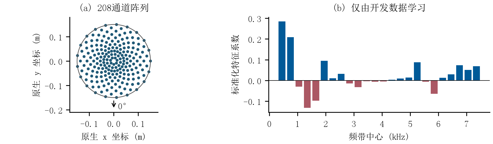
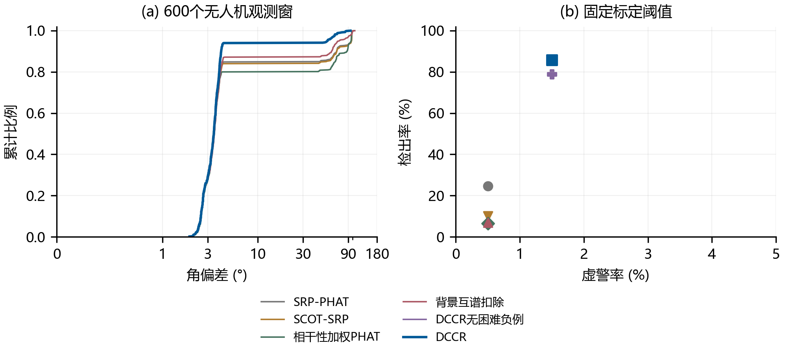
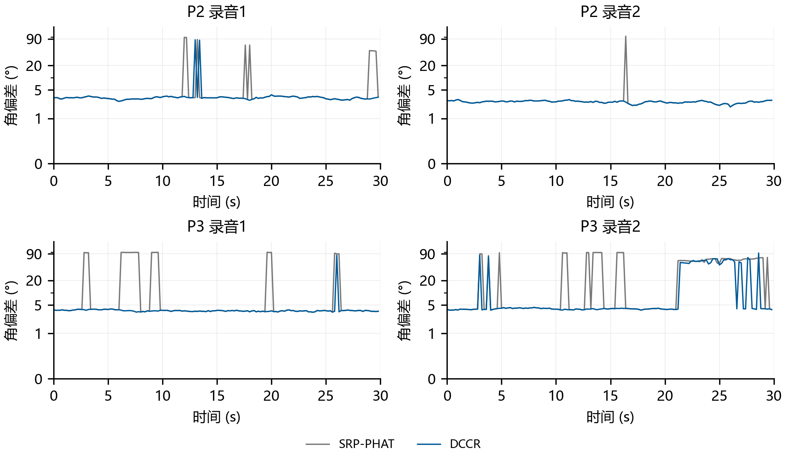

# 基于方向条件相干谱排序的小型无人机声学探测与测向

Ju Luo, Yuqian Zhou

南京航空航天大学

南京，中国

## 摘要

相干背景声源可能主导声学空间图并掩盖无人机方向。本文提出方向条件相干谱排序（DCCR），以24个相干频带特征和类别平衡岭回归对四个导向响应功率候选评分。208通道阵列录音按采集组划分：100 m用于开发，150 m和200 m用于保留评价。在600个无人机观测窗上，相对于标称参考方向的平均偏差由相位变换基线的{{PHAT_MEAN}}°降至{{RANK_MEAN}}°；检出率为{{RANK_TPR}}%，200个背景窗上的虚警率为{{RANK_FPR}}%。共用检测门控时，检出且定位偏差不超过10°的比例由{{SHARED_PHAT_JOINT}}%升至{{RANK_JOINT}}%。收益主要体现为大角度错误减少。证据限于单一机型、单日采集、标称静态参考、相关观测窗及本地背景标定。

**关键词** — 无人机声学，麦克风阵列，到达方向，空间相干性，候选方向排序。

## I 引言

被动声学感知需要在噪声环境中检出无人机辐射声并估计其方向，低信噪比会增加定位难度[1]。广义互相关用于估计麦克风对时延[2]，导向响应功率（steered response power，SRP）则在候选方向上汇总相关证据[3]、[4]。相位变换（phase transform，PHAT）强调相位一致性，相干非目标声源也可能主导空间响应。已有SRP扩展改善了频谱可靠性与空间搜索[4]，但将整幅空间图乘以相同的正检测权重，不会改变其最大值方向。

DCCR利用方向相干谱对四个SRP-PHAT候选排序。训练包含来自同一无人机观测的竞争方向，其背景和整体增益相同。本文贡献在于以既有阵列运算实现候选方向条件下的声源关联，并通过共用检测器的比较区分方向选择与报警决策的影响。

## II 相关研究

基于信噪比加权的波束形成与粒子跟踪[5]、PHAT-β部分频谱白化[6]及采用空间分离辅助麦克风的SRP[7]，分别在相应条件下处理噪声与混响问题。无人机方法包括旋翼谐波定位[8]、合成信号训练的神经定位[9]及稠密波束形成频谱图的U-Net分割[10]。EchoHawk结合检测与经典定位，并分析录音会话泄漏[11]。DCCR通过归一化频带相干特征和线性模型对四个候选排序，本文未与这些学习系统直接比较。DDL将音频与飞行日志位置同步[12]，UaVirBASE则记录实测静态配置[13]。本文数据提供标称静态方向，不含同步轨迹。

## III 信号模型与方向特征

### A 阵列与频谱估计

设麦克风位置为r_m，远场单位方向为u，接收信号近似为

$$ x_m(t)=a_m s(t+\mathbf{r}_m^{T}\mathbf{u}/c)+v_m(t). $$ (1)

其中a_m为通道增益，v_m包含背景与传感器噪声，声速c = 343 m/s。阵列孔径0.30 m远小于100–200 m标称距离。为消除平面阵列的镜像歧义，搜索限定于上半球。方位角a从原生负y方向顺时针计量，俯仰角e相对于阵列平面定义：

$$ \mathbf{u}(a,e)=(-\cos e\sin a,-\cos e\cos a,\sin e)^{T}. $$ (2)

每个200 ms观测窗按通道去均值，并通过抗混叠多相滤波由48 kHz重采样至16 kHz。512点周期Hann窗、256点帧移产生L = 11个去均值傅里叶帧，分析范围为300–7500 Hz。设X_m(l,k)为第l帧、第k频点的频谱，则平均互谱与自谱为

$$ R_{ij}(k)=L^{-1}\sum_{l=1}^{L}X_i(l,k)X_j(l,k)^{*},\qquad P_i(k)=R_{ii}(k). $$ (3)

相干归一化谱与PHAT谱分别为

$$ C_{ij}(k)=\frac{R_{ij}(k)}{\max(\sqrt{P_i(k)P_j(k)},\epsilon)},\qquad Q_{ij}(k)=\frac{R_{ij}(k)}{\max(|R_{ij}(k)|,\epsilon)}. $$ (4)

数值下限为带内平均通道功率的10⁻¹²倍，且不低于10⁻³⁰。先平均后归一化，避免单帧相干幅值恒为1。所有方法共用覆盖208通道的1124个通道对：按模208的索引偏移17、35、53、71、89和103构造，去重并保留基线不小于0.06 m的通道对。

### B 候选方向与相干特征

对于通道对集合P和频点集合F，未归一化的PHAT响应为

$$ B(\mathbf{u})=\sum_{(i,j)\in\mathcal{P}}\sum_{k\in\mathcal{F}}\operatorname{Re}\{Q_{ij}(k)e^{-j2\pi f_k(\mathbf{r}_i-\mathbf{r}_j)^{T}\mathbf{u}/c}\}. $$ (5)

水平方向余弦网格包含1257点、间隔0.05，按评分降序选取两两至少相隔12°的四个方向。各候选在±0.05邻域内以0.005间隔细化，再于方位角±1°、俯仰角±2°内以0.1°间隔细化。这些是数值搜索步长，不是物理精度保证。实现采用八倍插值逆FFT及线性时延查表，在固定比例因子下近似该响应。

将300–7500 Hz划分为24个相邻300 Hz频带，并包含末端频点。记第b个频带的频点集合为F_b，方向u的特征为

$$ f_b(\mathbf{u})=\frac{1}{|\mathcal{P}|\,|\mathcal{F}_b|}\sum_{(i,j)\in\mathcal{P}}\sum_{k\in\mathcal{F}_b}\operatorname{Re}\{C_{ij}(k)e^{-j2\pi f_k(\mathbf{r}_i-\mathbf{r}_j)^{T}\mathbf{u}/c}\}. $$ (6)

这些有符号特征保留随频率变化的方向支持程度。未触及数值下限时，正增益在归一化中抵消。回归模型仅接收24个频带值，不使用绝对功率、方向坐标、录音标识、距离或视频。图1给出了阵列几何和拟合系数。

## IV 模型学习与联合推理

### A 开发样本与正则化

P1包含300个无人机窗及100个背景窗，训练候选取自PHAT粗网格。参考导向波束和偏差不超过5°的候选为正例；偏差至少15°的候选及背景候选为负例；中间候选排除。推理不使用参考波束。1779个样本包括598个正例和1181个负例，其中781个为无人机观测中的错误方向。

两个分组折各保留一整段无人机录音及开发背景中连续10 s的一半，同一观测窗的样本保持在同一折。这不构成跨独立背景录音的泛化检验。特征均值与标准差在训练折内按类别平衡权重估计，标准差下限为0.01。对N个样本的标准化特征z_n和标签y_n ∈ {−1,+1}，模型最小化含岭惩罚[14]的加权目标

$$ \sum_{n=1}^{N}w_n(\boldsymbol{\beta}^{T}\mathbf{z}_n+b-y_n)^2+\lambda\|\boldsymbol{\beta}\|_2^2. $$ (7)

其中β为系数向量，b为截距。各类别权重之和为N/2，截距不正则化。平衡验证平方误差从{0.1，1，10，100}中选择λ = 100，再以全部开发样本拟合。消融模型仅去除781个错误方向负例，按相同分折选定λ = 10，其余推理过程不变。

### B 方向选择与标定

对四个由音频产生的候选，以训练特征均值μ和标准差σ计算

$$ s_q=\boldsymbol{\beta}^{T}[(\mathbf{f}(\mathbf{u}_q)-\boldsymbol{\mu})/\boldsymbol{\sigma}]+b,\qquad q^{*}=\operatorname{argmax}_{q}s_q. $$ (8)

所选方向和检测分数为u_q*及s_q*。该分数为回归输出而非后验概率。各方法使用每个测试组内相同的25个背景窗标定，其时段与评价窗不重叠。标称上尾水平为0.05时，顺序统计量秩ceil(26 × 0.95)为25；评分须严格大于标定最大值才判为检出。时间相关与非平稳性使其不具有正式5%虚警保证。所有无人机窗均估计方向，包括漏检窗；联合成功另要求检出且偏差≤10°。

## V 实测实验

### A 录音与评价划分

本文使用第四届“声华杯”声学技术大赛提供的录音：2026年5月25日，朝向上方的CRY8501/SonoCam Pi阵列采集DJI Air 3S声信号[15]。各采集组包含两段无人机录音和一段背景录音（表I），每段208通道、48 kHz、16位PCM。九段录音总计273.75 s。每段录音内各通道样本数一致，1872个WAV文件均无样本达到PCM边界，但这不独立验证相位或时钟标定。标称方向来自采集示意图，缺乏用于量化悬停位移及参考不确定性的同步轨迹。视频既不输入估计器，也不替代真值。

**表I 录音分组及标称方向，各组含两段无人机录音和一段背景录音。**

| 分组 | 标称距离 | 录音1／录音2方位角 | 俯仰角 | 用途 |
|---|---|---|---|---|
| P1 | 100 m | 225.00° / 251.50° | 88.3° | 方法开发 |
| P2 | 150 m | 97.17° / 92.41° | 60.0° | 保留评价 |
| P3 | 200 m | 131.88° / 135.00° | 66.4° | 保留评价 |

每段无人机录音使用前30 s；背景的[0,5)、[5,10)和[10,30) s分别用于谱扣除参考、阈值标定和负例评价。P2/P3提供600个无人机窗及200个背景窗，另有50个标定窗。P1仅用于开发。本地背景标定是明确的运行前提。

### B 比较方法与指标

基线共用几何、通道对、频带和搜索过程：SRP-PHAT；使用C_ij的平滑相干变换（smoothed coherence transform，SCOT）SRP；以及以Q_ij clip((L|C_ij|²−1)/(L−1),0,1)加权的相干PHAT。最后一项为有限快拍启发式，在重叠帧下不是无偏估计。背景扣除基线由当前与参考功率比的中位数估计通道增益，扣除缩放后的背景互谱，再由残余相干性及超额功率可靠性加权残余相位。代码给出完整运算，该基线并非文献[5]的复现。

分别使用各方法自己的标定检测器及共用的DCCR检测器评价方向结果；前者的实际虚警率不必相同。候选理想选择仅在推理结束后使用参考标签计算。估计与标称参考单位向量的角偏差为

$$ e_{\mathrm{ang}}=\frac{180}{\pi}\arccos[\operatorname{clip}(\widehat{\mathbf{u}}^{T}\mathbf{u}_{\mathrm{ref}},-1,1)]. $$ (9)

定位统计包含全部600个无人机窗；检出率及虚警率分别使用无人机和背景窗。800个观测窗存在时间相关性，不能视为独立试验，故采用描述性统计并列出四段录音的配对差值。代码、模型和输入哈希在保留评价前冻结。计时环境为Intel Core i7-12700KF、Python 3.12.14、NumPy 2.2.6和SciPy 1.15.3，数值库请求单线程；计时包含共用前端开销、排除文件读取，非隔离基准测试。

## VI 结果

### A 定位结果

{{LOCALIZATION_RESULTS}}

**表II 全部600个保留无人机窗相对于标称方向的偏差，包含漏检窗。**

{{LOCALIZATION_TABLE}}

{{RECORDING_RESULTS}}

**表III 各录音平均偏差。PHAT减DCCR的正差值表示改善，差值在四舍五入前计算。**

{{RECORDING_TABLE}}

图2汇总角偏差分布及检测工作点。

### B 检测与消融

{{DETECTION_RESULTS}}

**表IV 各方法独立标定后的检测与联合结果，检出率及虚警率分母分别为600个无人机窗和200个背景窗。**

{{DETECTION_TABLE}}

{{JOINT_RESULTS}}

{{ABLATION_RESULTS}}

{{TIMING_RESULTS}}

图3比较相同观测窗，两种估计器均未采用平滑或跟踪。

## VII 讨论

平均偏差下降主要源于大角度错误减少：中位数由3.49°变为3.47°，95百分位由96.87°降至54.16°。36个DCCR偏差超过10°的观测窗中，34个没有10°以内候选，33个来自P3录音2。候选覆盖限制了多数剩余大偏差的改善；排序器无法恢复候选集中不存在的方向。

存储背景谱与当前背景的时间失配可能限制直接扣除的效果。DCCR避免该扣除，但仍受机型、传播及传感器变化影响。证据来自单机型、单日及具有本地标定的六段保留录音，不是800次独立现场试验。标称静态参考无法分离悬停运动、朝向误差和相位失配；现有负例也未穷尽易混淆机械声和同时声源。距离估计、身份识别、多无人机分离及跟踪不在评价范围内。更广泛的验证需要新的开发数据及具有同步参考轨迹的独立录音。

## VIII 结论

{{CONCLUSION}}

## 参考文献

{{REFERENCES}}
